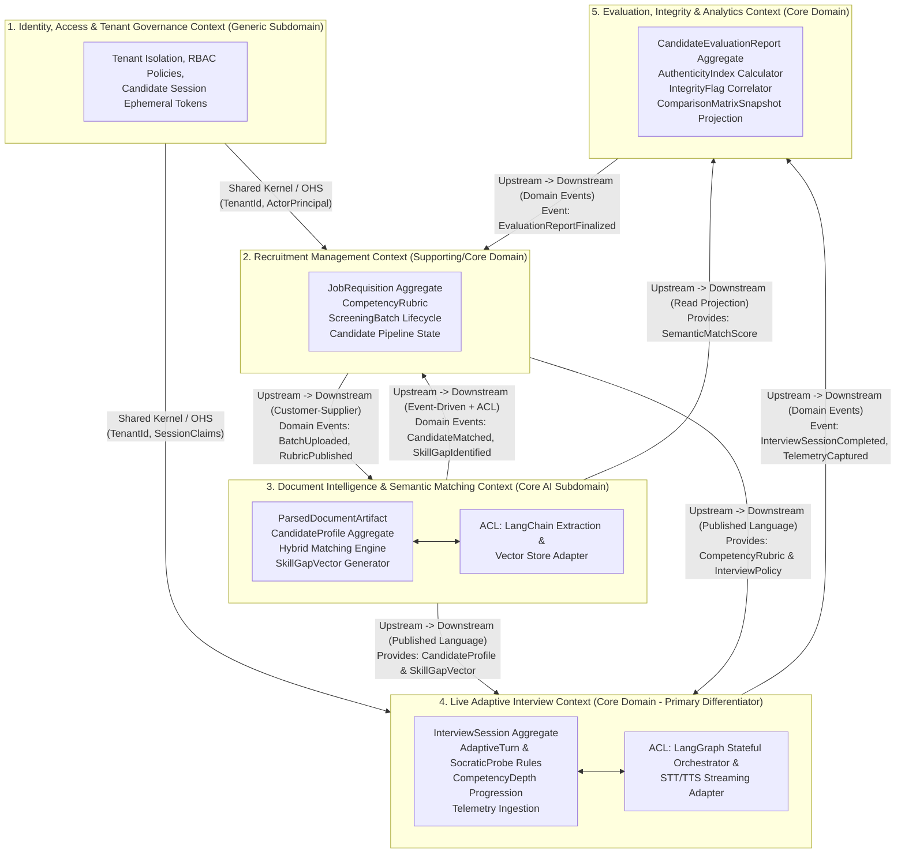
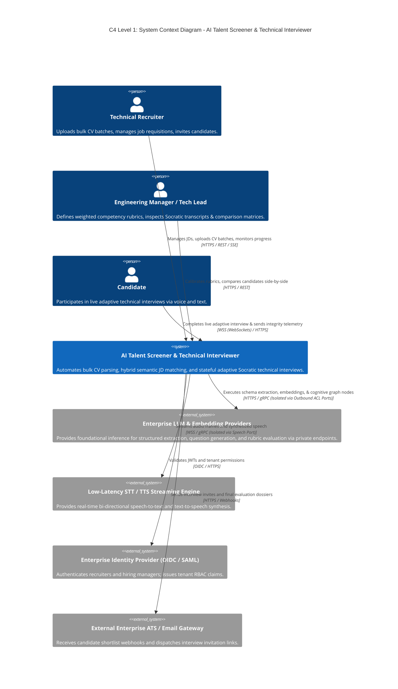
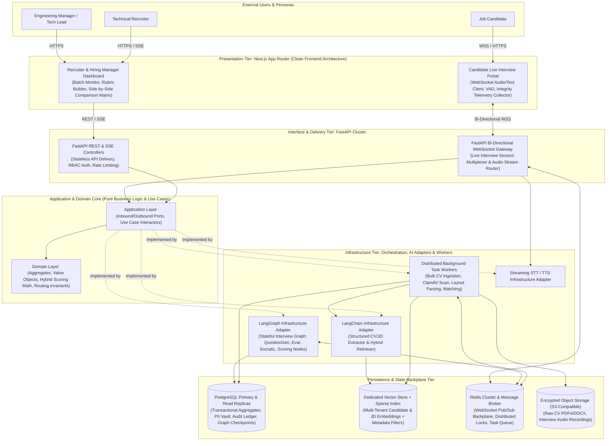

# AI Talent Screener & Technical Interviewer
## Phase 1: System Vision, PRD, Strategic & Tactical DDD Blueprint

* **Document ID:** `ARCH-SPEC-PHASE-01`
* **Architectural Paradigm:** Clean Architecture, Hexagonal Ports & Adapters, Strategic & Tactical Domain-Driven Design (DDD)
* **Implementation Policy:** Strict Zero-Code Conceptual & Mathematical Specification
* **Target System:** Enterprise AI Talent Screener & Stateful Adaptive Technical Interviewer

---

## 1. Executive Summary & Problem Statement

### 1.1 Business Context & Operational Bottleneck
Enterprise technology organizations and high-growth recruiting teams face an acute operational bottleneck in technical talent acquisition. For a typical Senior Software Engineer requisition receiving $N = 500$ applications, talent acquisition specialists and senior engineers expend hundreds of high-value engineering hours manually parsing heterogeneously formatted CVs (PDF, DOCX), subjectively matching candidate claims against Job Descriptions (JDs), and conducting repetitive first-round technical screening calls.

Traditional Applicant Tracking Systems (ATS) rely on brittle keyword heuristics that penalize qualified candidates who use non-standard terminology while failing to detect exaggerated or AI-fabricated resumes. Furthermore, static pre-recorded video assessments or asynchronous coding quizzes lack the dynamic, conversational probing required to verify genuine architectural understanding, problem-solving depth, and real-time authenticity.

The **AI Talent Screener & Technical Interviewer** eliminates this bottleneck by orchestrating two core autonomous capabilities within strict Clean Architecture boundaries:
1. **High-Throughput Document Intelligence & Hybrid Semantic Matching:** An asynchronous ingestion pipeline that extracts structured competency evidence from bulk CV uploads and evaluates candidates against weighted JD rubrics using a hybrid mathematical formulation (Dense Vector Similarity + Sparse Lexical BM25 + Hard-Skill Gatekeepers + Experience Recency Decay).
2. **Stateful Adaptive Technical Interviewing:** A real-time, bi-directional voice and text interview engine powered by a stateful cognitive graph. It dynamically generates contextual technical questions targeting individual candidate skill gaps, evaluates responses in real time against multi-dimensional rubrics, executes Socratic follow-up probes when answers are shallow or suspiciously synthetic, and synthesizes a comprehensive evaluation report coupled with a real-time **Integrity & Authenticity Index**.

### 1.2 Quantifiable Business Value & Target ROI
Given an enterprise baseline processing $B$ requisitions per quarter with $C$ candidates per requisition, total manual screening effort $E_{\text{manual}}$ is defined as:

$$E_{\text{manual}} = B \times \left( C \times t_{\text{cv}} + C \times p_{\text{screen}} \times t_{\text{interview}} \right)$$

Where:
* $t_{\text{cv}} \approx 0.10\text{ hours}$ ($6\text{ minutes}$) is the average manual CV review time.
* $p_{\text{screen}} \approx 0.15$ is the fraction of applicants advancing to initial technical phone screens.
* $t_{\text{interview}} \approx 0.75\text{ hours}$ ($45\text{ minutes}$ including scheduling, execution, and scorecard write-up) is the engineering time per initial screen.

By automating 100% of initial CV triage and first-round adaptive technical interviews, the platform reduces human screening effort to reviewing only the top $p_{\text{shortlist}} \approx 0.03$ of verified candidates via the **Side-by-Side Candidate Comparison Matrix**, achieving an expected engineering time reduction exceeding $85\%$.

### 1.3 Target Personas & System Actors

| Persona Name | Role & Organizational Context | Primary Pain Points | System Value Proposition & Core Workflows |
| :--- | :--- | :--- | :--- |
| **Technical Recruiter (Talent Acquisition Specialist)** | Manages high-volume requisitions, candidate sourcing, bulk CV uploads, and pipeline progression. | Overwhelmed by 300–1,000+ CVs per role; lacks deep technical domain knowledge to distinguish surface-level buzzwords from real engineering depth. | Uploads bulk CV batches (up to 500 files); configures JD weighting templates; monitors real-time batch parsing telemetry; reviews automated shortlists and dispatches adaptive interview invitations. |
| **Engineering Manager / Tech Lead (Hiring Manager)** | Defines technical competency rubrics, evaluates top candidates, and makes hiring decisions. | Loses 10–15 hours weekly conducting repetitive L1 technical screening calls where candidates fail basic architectural fundamentals. | Calibrates `CompetencyRubric` weights and minimum depth thresholds; inspects granular per-turn Socratic interview transcripts, rubric breakdowns, and `IntegrityFlag` telemetry; compares finalists in the **Side-by-Side Candidate Comparison Matrix**. |
| **Candidate (Job Applicant)** | Applies for technical roles and participates in the interactive screening interview. | Faces "black-hole" ATS rejections due to keyword mismatches; experiences rigid, impersonal one-way video recordings. | Engages in a low-latency, interactive voice/text technical dialogue tailored to their actual resume projects; receives fair, Socratic opportunities to clarify and elaborate on complex technical trade-offs. |
| **Enterprise Security & Compliance Officer** | Audits data privacy (GDPR/CCPA), AI fairness, PII redaction, and anti-cheating controls. | Uncontrolled LLM usage leaking candidate PII or exhibiting demographic bias during automated screening. | Enforces zero-PII evaluation pipelines, immutable audit trails of every scoring mutation, deterministic rubric anchoring, and non-intrusive client-side integrity telemetry. |

### 1.4 Core System Key Performance Indicators (KPIs)

| KPI Identifier | Metric Name | Mathematical Formulation / Measurement Definition | Production Target SLA / Goal |
| :--- | :--- | :--- | :--- |
| **KPI-BUS-01** | **Time-to-Shortlist Reduction ($\Delta T_{\text{shortlist}}$)** | $$\Delta T_{\text{shortlist}} = \frac{T_{\text{manual}} - T_{\text{automated}}}{T_{\text{manual}}} \times 100\%$$ | $\ge 88\%$ reduction (from 14 days to $\le 24\text{ hours}$ per 500-candidate batch). |
| **KPI-BUS-02** | **Hiring Manager Onsite Pass-Through Rate ($R_{\text{pass}}$)** | $$R_{\text{pass}} = \frac{\text{Candidates Advancing Past Human Technical Round}}{\text{Candidates Recommended by AI Interviewer}}$$ | $\ge 72\%$ correlation with senior human engineering evaluators. |
| **KPI-AI-01** | **Rubric Grading Concordance ($\kappa_{\text{eval}}$)** | Quadratic Weighted Cohen's Kappa ($\kappa_w$) between AI Evaluation Node scores and blind human SME panels across 5-point competency scales. | $\kappa_w \ge 0.82$ across all core technical competencies. |
| **KPI-AI-02** | **Adversarial & Synthetic Response Detection Recall ($R_{\text{integrity}}$)** | $$R_{\text{integrity}} = \frac{\text{True Positives (Flagged LLM-Assisted / Prompt-Injected Turns)}}{\text{Total Controlled Adversarial Test Turns}}$$ | $\ge 94\%$ recall with False Positive Rate (FPR) $\le 2.5\%$. |
| **KPI-SYS-01** | **Live Interview Conversational Turn Latency ($L_{\text{turn}}$)** | $$L_{\text{turn}} = t_{\text{STT\_final}} + t_{\text{Graph\_Eval}} + t_{\text{Graph\_Gen}} + t_{\text{TTS\_first\_byte}}$$ | $P_{50} \le 1,100\text{ ms}$, $P_{95} \le 1,850\text{ ms}$, $P_{99} \le 2,400\text{ ms}$. |
| **KPI-SYS-02** | **Bulk CV Ingestion & Matching Throughput ($\Theta_{\text{batch}}$)** | Total elapsed wall-clock time to virus-scan, OCR/parse, extract structured entities, embed, and score 500 multi-page CVs. | $\le 180\text{ seconds}$ ($P_{95}$) for a 500-CV batch ($\ge 2.77\text{ CVs/sec}$ sustained). |

---

## 2. Strategic Domain-Driven Design (DDD)

### 2.1 Architecture Decision Record: ADR-001 (Foundational Paradigm)

| ADR Field | Specification Details |
| :--- | :--- |
| **Identifier** | **ADR-001: Adoption of Clean Architecture, Hexagonal Ports & Adapters, and Domain-Driven Design** |
| **Status** | Accepted & Enforced |
| **Context** | Enterprise AI applications frequently suffer from tight coupling between core business rules (e.g., hiring rubrics, candidate state machines, scoring algorithms) and rapidly evolving AI orchestration frameworks (LangChain, LangGraph, specific LLM vendor SDKs, vector databases). When prompt structures, LLM providers, or embedding dimensions change, tightly coupled systems require invasive rewrites across API controllers and database schemas. |
| **Decision** | Enforce Robert C. Martin's **Clean Architecture** combined with **Strategic & Tactical DDD**. The **Domain Layer** contains pure, framework-agnostic business entities, value objects, invariants, and domain scoring mathematics. The **Application Layer** orchestrates domain workflows via Use Cases and defines strict Inbound/Outbound Ports. **LangChain** (document extraction and hybrid retrieval) and **LangGraph** (stateful interview execution) are strictly confined to the **Infrastructure Layer** behind Anti-Corruption Layers (ACLs) implementing Outbound Driven Ports. |
| **Alternatives Considered** | 1. *Framework-Centric MVC (FastAPI routes directly invoking LangChain/LangGraph chains):* Rejected due to untestable business invariants, vendor lock-in, and inability to unit-test rubric logic without live LLM calls. 2. *Microservices per Bounded Context from Day 1:* Rejected in favor of a **Modular Monolith with Strict Bounded Context Isolation** and asynchronous worker topologies, preventing distributed monolith network overhead while preserving clean context boundaries for future extraction. |
| **Consequences** | *Positive:* 100% deterministic unit testability of domain logic; zero-downtime hot-swapping of LLM providers or vector stores; explicit boundary protection against third-party library breaking changes. *Negative / Trade-offs:* Requires explicit DTO-to-Domain mapping across layer boundaries and disciplined governance to prevent infrastructure types from leaking inward. |

### 2.2 Ubiquitous Language Glossary

Every engineer, product manager, domain expert, and AI agent working on the platform must use the following canonical terminology without deviation or synonyms:

| Ubiquitous Term | Bounded Context Owner | Rigorous Domain Definition |
| :--- | :--- | :--- |
| **JobRequisition** | Recruitment Management | An authoritative hiring mandate representing an open technical role, encapsulating its structured Job Description, required seniority level, hiring pipeline stages, and associated `CompetencyRubric`. |
| **CompetencyRubric** | Recruitment Management | A hierarchical, weighted evaluation framework attached to a `JobRequisition`. It defines specific technical competencies, classification tiers (*Must-Have Gatekeeper* vs. *Nice-to-Have Differentiator*), target mastery depth levels ($L_1$ to $L_5$), and behavioral scoring anchors. |
| **ScreeningBatch** | Recruitment Management | A tracked transactional unit representing a bulk upload of $1 \dots N$ raw candidate resume files submitted by a Recruiter against a specific `JobRequisition`. |
| **ParsedDocumentArtifact** | Document Intelligence | An immutable, structured representation of a raw CV or JD file after virus verification, layout-aware text extraction, PII tokenization, and schema-constrained entity extraction. |
| **CandidateProfile** | Document Intelligence | The canonical domain representation of an applicant's professional history, normalized skills, quantified project complexity metrics, role tenures, and academic credentials derived from a `ParsedDocumentArtifact`. |
| **SemanticMatchScore** | Document Intelligence | A composite, mathematically bounded score $S_{\text{match}} \in [0.0, 100.0]$ quantifying the alignment between a `CandidateProfile` and a `JobRequisition`, synthesized from dense vector similarity, sparse lexical matching, hard-skill gatekeepers, and experience recency decay. |
| **SkillGapVector** | Document Intelligence | A prioritized collection of missing, weakly evidenced, or ambiguous competencies identified when comparing a `CandidateProfile` against a `CompetencyRubric`. Serves as the primary targeting seed for the live interview engine. |
| **InterviewSession** | Live Interview | A stateful, time-bounded conversational assessment instance linking a specific Candidate and a `JobRequisition`, governed by a deterministic lifecycle state machine and backed by a persistent graph execution checkpoint. |
| **CompetencyDepthLevel** | Live Interview | An ordinal mastery scale ($L_1$: *Conceptual Familiarity*, $L_2$: *Applied Implementation*, $L_3$: *Debugging & Edge Cases*, $L_4$: *System Trade-offs & Scaling*, $L_5$: *Architectural Invention*) tracked per competency during an `InterviewSession`. |
| **AdaptiveTurn** | Live Interview | A single atomic conversational exchange within an `InterviewSession`, consisting of the AI Interviewer's prompt/question, the candidate's multi-modal response (transcript + audio/timing metadata), real-time telemetry, and the resulting `TurnEvaluation`. |
| **SocraticProbe** | Live Interview | A targeted follow-up question triggered via conditional graph branching when a candidate's response in an `AdaptiveTurn` is evaluated as surface-level, ambiguous, evasive, or indicative of unverified AI assistance. |
| **IntegrityTelemetrySignal** | Live Interview | An immutable client-side or server-side behavioral observation captured during an `AdaptiveTurn` (e.g., browser tab focus loss, clipboard paste burst, abnormal speech-to-text cadence, zero-latency complex syntax delivery). |
| **IntegrityFlag** | Evaluation & Analytics | A domain warning raised when correlated `IntegrityTelemetrySignal` instances or linguistic patterns cross a mathematical suspicion threshold, categorized by severity (*Low*, *Medium*, *High*, *Critical*). |
| **AuthenticityIndex** | Evaluation & Analytics | A probabilistic composite score $I_{\text{auth}} \in [0.0, 1.0]$ estimating the likelihood that the candidate's interview responses reflect genuine, unassisted human expertise. |
| **CandidateEvaluationReport** | Evaluation & Analytics | The immutable final dossier produced upon completion of an `InterviewSession`, aggregating per-competency rubric scores, achieved depth levels, evidence citations, `AuthenticityIndex`, and an overall hiring recommendation tier. |
| **ComparisonMatrixSnapshot** | Evaluation & Analytics | A normalized, multi-dimensional analytical projection comparing $2 \dots 4$ shortlisted candidates side-by-side across rubric dimensions, `SemanticMatchScore`, `CompetencyDepthLevel` achieved, and `AuthenticityIndex`. |

### 2.3 Bounded Contexts & Context Mapping

The system is partitioned into **five explicit Bounded Contexts**. Cross-context communication is strictly governed through Domain Events, Open Host Services (OHS), and Anti-Corruption Layers (ACLs).

#### Strategic Context Map Specification Matrix

| Upstream Context | Downstream Context | DDD Context Mapping Pattern | Integration Mechanism & Anti-Corruption Strategy |
| :--- | :--- | :--- | :--- |
| **Identity & Tenant Governance** | *All Contexts* | **Shared Kernel / Open Host Service (OHS)** | Supplies immutable `TenantId`, `ActorIdentity`, and cryptographic session claims. Enforces strict multi-tenant row and vector namespace isolation across all downstream contexts. |
| **Recruitment Management** | **Document Intelligence** | **Customer-Supplier (Asynchronous Event-Driven)** | Recruitment Management publishes `ScreeningBatchSubmitted` and `JobRequisitionPublished` Domain Events. Document Intelligence consumes these via an Inbound Event Port, translating raw file URIs and JD criteria through an internal ACL. |
| **Document Intelligence** | **Recruitment Management** | **Conformist / Event Notification** | Document Intelligence emits `DocumentParsingCompleted`, `DocumentParsingFailed`, and `CandidateSemanticMatchCalculated` events to update batch progress and candidate tiering in Recruitment Management. |
| **Recruitment Management** & **Document Intelligence** | **Live Adaptive Interview** | **Published Language (PL) + Anti-Corruption Layer (ACL)** | When an interview is scheduled, Live Interview fetches a frozen snapshot of the `CompetencyRubric` (from Recruitment Management) and the `CandidateProfile` + `SkillGapVector` (from Document Intelligence) via an ACL that converts them into an immutable `InterviewBriefingContext` Value Object. Mutations to the JD after an interview begins do not corrupt the active session. |
| **Live Adaptive Interview** | **Evaluation, Integrity & Analytics** | **Customer-Supplier via Domain Events** | Upon termination or completion of an interview, Live Interview emits `InterviewSessionConcluded` carrying the full ledger of `AdaptiveTurn` evaluations and `IntegrityTelemetrySignal` records. Evaluation & Analytics translates this ledger into a finalized `CandidateEvaluationReport`. |
| **External AI Frameworks (LangChain, LangGraph, LLMs, Vector DB)** | **Document Intelligence** & **Live Adaptive Interview** | **Strict Anti-Corruption Layer (ACL)** | External AI frameworks are treated as volatile third-party suppliers. Neither Domain nor Application layers import or reference LangChain/LangGraph primitives; all state dicts, prompt templates, and tool calls are encapsulated inside Infrastructure Adapters implementing Application Outbound Ports. |

---

## 3. Tactical DDD Building Blocks

### 3.1 Bounded Context 1: Recruitment Management Context

| Tactical Building Block | Component Name | Detailed Architectural Specification & Responsibilities |
| :--- | :--- | :--- |
| **Aggregate Root** | `JobRequisition` | Controls the lifecycle of a job opening (`Draft` $\rightarrow$ `Published` $\rightarrow$ `Paused` $\rightarrow$ `Closed`). Owns the `CompetencyRubric` and screening threshold policies. All changes to rubric weights must pass through `JobRequisition` methods to guarantee weight normalization invariants. |
| **Aggregate Root** | `ScreeningBatch` | Tracks bulk CV ingestion requests (`Initialized` $\rightarrow$ `Processing` $\rightarrow$ `Completed` / `PartiallyFailed` / `Failed`). Maintains atomic counters for total files, processed files, failed files, and shortlisted candidates. |
| **Internal Entity** | `RubricCompetencyItem` | Lives inside `JobRequisition`. Represents an individual technical skill or architectural domain to be evaluated, including its criticality tier and target `CompetencyDepthLevel`. |
| **Internal Entity** | `BatchFileEntry` | Lives inside `ScreeningBatch`. Tracks the state of a single uploaded document (file hash, storage URI, virus scan status, parsing status, and failure reason code). |
| **Value Object** | `CompetencyRubric` | Immutable composite structure containing a collection of `RubricCompetencyItem` records, global category weights ($\alpha_{\text{dense}}, \beta_{\text{sparse}}, \gamma_{\text{recency}}$), and minimum interview qualification thresholds. |
| **Value Object** | `ThresholdPolicy` | Immutable configuration defining automatic tiering cutoffs: `AutoInviteThreshold` ($\theta_{\text{invite}}$), `ManualReviewThreshold` ($\theta_{\text{review}}$), and `MaxInterviewDurationMinutes`. |
| **Domain Service** | `RubricCalibrationService` | Validates and normalizes multi-competency weight distributions across Must-Have and Nice-to-Have criteria so that total relative weights sum to unity ($1.0$). |
| **Business Invariants** | **INV-RM-01:** Normalized Rubric Weights **INV-RM-02:** Immutable Active Rubric **INV-RM-03:** Batch Size & Dedup | 1. **INV-RM-01:** For any published `CompetencyRubric`, the sum of competency weights $\sum_{i=1}^{k} w_i$ must equal $1.0 \pm 10^{-6}$, and at least one competency must be designated as a `MustHaveGatekeeper`. 2. **INV-RM-02:** A `CompetencyRubric` attached to a `JobRequisition` with active or completed `InterviewSession` records cannot be mutated in place; modifications must spawn a new versioned `RubricVersionId`. 3. **INV-RM-03:** A `ScreeningBatch` cannot exceed $500$ files per submission, and duplicate SHA-256 file hashes within the same `JobRequisition` are automatically rejected as idempotent duplicates. |
| **Domain Events** | `JobRequisitionPublished` `ScreeningBatchSubmitted` `CandidateShortlistedForInterview` | Emitted when transactional state transitions commit; triggers asynchronous document ingestion, semantic re-indexing, and automated candidate interview invitation workflows. |

### 3.2 Bounded Context 2: Document Intelligence & Semantic Matching Context

| Tactical Building Block | Component Name | Detailed Architectural Specification & Responsibilities |
| :--- | :--- | :--- |
| **Aggregate Root** | `CandidateProfile` | Canonical representation of an applicant's extracted qualifications, normalized skills taxonomy, work history chronology, and project impact evidence. |
| **Aggregate Root** | `ApplicationMatchEvaluation` | Encapsulates the deterministic matching result binding a `CandidateProfile` to a specific `JobRequisition` and `RubricVersionId`. Owns the `SemanticMatchScore` and `SkillGapVector`. |
| **Internal Entity** | `ExperienceRecord` | Chronological employment or project entry within `CandidateProfile`, storing start/end dates, role title, normalized technology tags, quantified impact claims, and calculated duration in months. |
| **Value Object** | `ParsedDocumentArtifact` | Immutable representation of extracted raw text sections, document layout metadata, redaction audit map (PII tokens), and extraction confidence score. |
| **Value Object** | `NormalizedSkillTag` | Immutable canonical skill identifier mapped to a standardized engineering taxonomy (e.g., resolving `"K8s"`, `"Kubernetes Engine"`, and `"Kubernetes"` to canonical ID `SKILL_KUBERNETES_CORE`), paired with estimated months of hands-on experience and recency timestamp. |
| **Value Object** | `SemanticMatchScore` | Immutable mathematical tuple containing `TotalCompositeScore` ($S_{\text{match}} \in [0, 100]$), `DenseVectorScore`, `SparseLexicalScore`, `GatekeeperPassBoolean`, `RecencyMultiplier`, and `TierClassification` (`AUTO_INVITE`, `MANUAL_REVIEW`, `REJECTED`). |
| **Value Object** | `SkillGapVector` | Ordered immutable list of `SkillGapItem` objects specifying `CompetencyId`, `GapType` (`MISSING_EVIDENCE`, `BELOW_SENIORITY_DEPTH`, `STALE_EXPERIENCE`, `UNVERIFIED_CLAIM`), and `ProbePriorityWeight`. |
| **Domain Service** | `HybridSemanticScoringService` | Executes the pure mathematical ranking formulation combining vector cosine similarity, BM25 lexical scores, recency decay, and hard-skill gatekeeper penalties to produce `SemanticMatchScore` and `SkillGapVector`. |
| **Business Invariants** | **INV-DI-01:** Zero-PII Scoring Guarantee **INV-DI-02:** Gatekeeper Veto Rule **INV-DI-03:** Chronological Integrity | 1. **INV-DI-01:** `CandidateProfile` embeddings and `HybridSemanticScoringService` inputs must never contain candidate PII (Name, Email, Phone, Gender, Age, Physical Address, Photograph) to prevent demographic bias. 2. **INV-DI-02:** If a candidate fails any `MustHaveGatekeeper` competency with zero adjacent semantic equivalence, the candidate cannot be classified as `AUTO_INVITE` regardless of dense vector similarity. 3. **INV-DI-03:** Overlapping concurrent `ExperienceRecord` intervals are de-duplicated when computing total cumulative years of experience for a skill so a candidate cannot double-count parallel projects within the same calendar period. |
| **Domain Events** | `DocumentArtifactExtracted` `CandidateProfileConstructed` `SemanticMatchComputed` `DocumentIngestionQuarantined` | Synchronizes vector store indexing, updates `ScreeningBatch` progress counters, and feeds the `SkillGapVector` to downstream interview initialization. |

### 3.3 Bounded Context 3: Live Adaptive Interview Context

| Tactical Building Block | Component Name | Detailed Architectural Specification & Responsibilities |
| :--- | :--- | :--- |
| **Aggregate Root** | `InterviewSession` | Governs the end-to-end lifecycle of a technical screening interview (`Scheduled` $\rightarrow$ `Ready` $\rightarrow$ `InProgress` $\rightarrow$ `PausedDisconnected` $\rightarrow$ `Completed` / `TerminatedEarly` / `Expired`). Enforces turn limits, timeboxes, competency progression, and Socratic branching invariants. |
| **Internal Entity** | `AdaptiveTurn` | Represents a single question-and-response cycle within `InterviewSession`. Stores turn sequence number, targeted `CompetencyId`, `CompetencyDepthLevel` attempted, AI question prompt, candidate response transcript, response latency metrics, and `TurnEvaluation`. |
| **Internal Entity** | `CompetencyProgressTracker` | Tracks per-competency state inside `InterviewSession`: starting depth level, current achieved depth level, number of primary questions asked, number of `SocraticProbe` follow-ups triggered, and cumulative evidence score. |
| **Value Object** | `InterviewBriefingContext` | Immutable snapshot captured at session initialization containing anonymized candidate project highlights, the frozen `CompetencyRubric`, and the prioritized `SkillGapVector`. |
| **Value Object** | `TurnEvaluation` | Immutable real-time assessment of a candidate's response across three orthogonal dimensions: `TechnicalAccuracy` ($[0.0, 5.0]$), `DepthOfUnderstanding` ($[0.0, 5.0]$), `PracticalRelevance` ($[0.0, 5.0]$), plus `SuspicionScore` ($[0.0, 1.0]$), `DetectedDeficiencies`, and `RoutingRecommendation` (`ADVANCE_DEPTH`, `SOCRATIC_PROBE`, `PIVOT_COMPETENCY`, `TERMINATE_SESSION`). |
| **Value Object** | `SocraticProbeDirective` | Immutable instruction generated when an answer requires deeper verification, specifying `ProbeStrategy` (`CLARIFY_VAGUE_CLAIM`, `CHALLENGE_ARCHITECTURAL_TRADEOFF`, `VERIFY_PRODUCTION_DEBUGGING`, `AUTHENTICITY_TRAP_CHECK`) and the specific conceptual gap to target. |
| **Value Object** | `IntegrityTelemetrySignal` | Immutable telemetry event recording `SignalType` (`TAB_VISIBILITY_LOST`, `CLIPBOARD_PASTE_DETECTED`, `SECONDARY_MONITOR_FOCUS`, `ABNORMAL_CADENCE_BURST`, `PROMPT_INJECTION_ATTEMPT`), `TimestampUtc`, `DurationMs`, and `TurnSequenceNumber`. |
| **Domain Service** | `AdaptiveRoutingPolicyService` | Deterministic domain policy engine that evaluates the current `TurnEvaluation`, `CompetencyProgressTracker`, remaining session time budget, and follow-up counters to adjudicate the exact next state transition in the interview graph. |
| **Business Invariants** | **INV-LI-01:** Socratic Loop Bound **INV-LI-02:** Single Active Turn **INV-LI-03:** Strict Timebox & Competency Coverage **INV-LI-04:** Untrusted Candidate Input | 1. **INV-LI-01:** The number of consecutive `SocraticProbe` follow-ups for any single `CompetencyId` must never exceed $N_{\text{max\_probes}} = 2$. Upon reaching $N_{\text{max\_probes}}$, the session must deterministically pivot to the next competency to prevent infinite loops. 2. **INV-LI-02:** An `InterviewSession` may have at most one awaiting `AdaptiveTurn` at any instant; concurrent candidate responses for the same turn sequence number are rejected via optimistic concurrency control. 3. **INV-LI-03:** All `MustHaveGatekeeper` competencies in the `InterviewBriefingContext` must be probed before any `NiceToHave` competency is selected. 4. **INV-LI-04:** Candidate utterances are never permitted to mutate `CompetencyRubric` weights, override previous `TurnEvaluation` records, or access system instructions. |
| **Domain Events** | `InterviewSessionStarted` `AdaptiveTurnEvaluated` `SocraticProbeTriggered` `IntegrityAnomalyDetected` `InterviewSessionConcluded` | Drives real-time WebSocket UI updates, triggers checkpoint persistence, and notifies the Evaluation & Analytics Context upon session conclusion. |

### 3.4 Bounded Context 4: Evaluation, Integrity & Analytics Context

| Tactical Building Block | Component Name | Detailed Architectural Specification & Responsibilities |
| :--- | :--- | :--- |
| **Aggregate Root** | `CandidateEvaluationReport` | The authoritative, immutable post-interview evaluation record. Synthesizes pre-interview `SemanticMatchScore`, per-competency interview rubric scores, `AuthenticityIndex`, `IntegrityFlag` list, executive strengths/weaknesses summary, and final hiring decision tier. |
| **Internal Entity** | `CompetencyScorecardEntry` | Detailed assessment of a single competency within `CandidateEvaluationReport`, linking required depth vs. achieved `CompetencyDepthLevel`, weighted score, verbatim transcript evidence quotes, and evaluator rationale. |
| **Value Object** | `AuthenticityIndex` | Immutable composite metric $I_{\text{auth}} \in [0.0, 1.0]$ with confidence interval, derived from behavioral telemetry penalties, linguistic entropy analysis, and Socratic verification consistency. |
| **Value Object** | `IntegrityFlag` | Immutable audit warning containing `FlagCode`, `Severity` (`LOW`, `MEDIUM`, `HIGH`, `CRITICAL`), `SupportingSignalIds`, `TurnNumbersAffected`, and `HumanReviewerGuidance`. |
| **Value Object** | `ComparisonMatrixSnapshot` | Read-optimized analytical Value Object normalizing $2 \dots 4$ `CandidateEvaluationReport` aggregates across shared rubric axes for side-by-side rendering on the Recruiter Dashboard. |
| **Domain Service** | `IntegrityCorrelationService` | Correlates client-side `IntegrityTelemetrySignal` streams with linguistic evaluation anomalies (e.g., a `TAB_VISIBILITY_LOST` event lasting $4,500\text{ ms}$ immediately followed by a textbook $L_5$ architectural answer that subsequently fails a $L_3$ `SocraticProbe`) to compute `AuthenticityIndex` and emit `IntegrityFlag` records. |
| **Domain Service** | `CandidateComparisonProjectionService` | Normalizes multi-candidate scores across heterogeneous interview paths (accounting for different Socratic probe counts and difficulty depths) to guarantee mathematically fair side-by-side comparison. |
| **Business Invariants** | **INV-EA-01:** Evidence-Backed Scoring **INV-EA-02:** Integrity Never Auto-Rejects Without Flag **INV-EA-03:** Report Immutability | 1. **INV-EA-01:** Every `CompetencyScorecardEntry` score must reference at least one concrete `AdaptiveTurn` sequence ID as verifiable audit evidence. 2. **INV-EA-02:** A low `AuthenticityIndex` ($I_{\text{auth}} < 0.50$) must never silently alter technical competency scores; technical proficiency and integrity are reported as orthogonal dimensions so human hiring managers retain final governance. 3. **INV-EA-03:** Once finalized, a `CandidateEvaluationReport` is cryptographically hashed and immutable; human recruiter overrides are appended as separate audit annotations. |
| **Domain Events** | `CandidateEvaluationReportGenerated` `HighSeverityIntegrityFlagRaised` `ComparisonMatrixExported` | Notifies recruiters and hiring managers, updates the candidate pipeline stage in Recruitment Management, and logs compliance audit trails. |

---

## 4. Conceptual Data Contracts & Domain Schemas

In accordance with the **Strict Zero-Code Policy**, the core domain aggregates and value objects are specified below as conceptual data contracts.

### 4.1 Conceptual Schema: `JobRequisition` & `CompetencyRubric`

| Field Name | Conceptual Data Type | Constraints & Validation Rules | Domain Purpose |
| :--- | :--- | :--- | :--- |
| `requisition_id` | UUIDv7 | Required, Primary Identifier, Immutable, Time-ordered | Globally unique identifier for the `JobRequisition` aggregate root. |
| `tenant_id` | UUIDv4 | Required, Indexed, Non-Null | Enforces multi-tenant isolation across all queries and storage layers. |
| `title` | Normalized String | Required, Length $\in [5, 120]$ chars | Canonical job title (e.g., `"Staff Distributed Systems Engineer"`). |
| `seniority_band` | Enumerated Token | Required, $\in \{\text{L3\_JUNIOR}, \text{L4\_MID}, \text{L5\_SENIOR}, \text{L6\_STAFF}, \text{L7\_PRINCIPAL}\}$ | Anchors baseline expectations for `CompetencyDepthLevel` during matching and interviewing. |
| `rubric_version_id` | UUIDv7 | Required, Immutable per published revision | Tracks point-in-time rubric snapshots to satisfy invariant **INV-RM-02**. |
| `competency_items` | Ordered Set of `RubricCompetencyItem` | Required, Cardinality $\in [3, 12]$ items | Defines the technical skills, weights, and required depths for the role. |
| `competency_items[].competency_id` | UUIDv4 | Required, Unique within rubric | Identifier linking rubric requirements to `SkillGapVector` and `AdaptiveTurn`. |
| `competency_items[].canonical_skill_id` | Taxonomy Token | Required, Matches standard skill ontology | Links competency to normalized CV skills (e.g., `SKILL_DISTRIBUTED_CONSENSUS`). |
| `competency_items[].weight` | Decimal ($p=5, s=4$) | Required, $w_i \in (0.0000, 1.0000]$, $\sum w_i = 1.0000$ | Relative importance of this competency in both CV matching and interview scoring. |
| `competency_items[].is_gatekeeper` | Boolean | Required, At least $1$ item must be `True` | Marks whether missing this skill triggers **INV-DI-02** gatekeeper veto. |
| `competency_items[].target_depth_level` | Ordinal Integer | Required, $\in \{1, 2, 3, 4, 5\}$ | Target `CompetencyDepthLevel` ($L_1 \dots L_5$) expected during the live interview. |
| `matching_weights` | Composite Tuple $(\alpha, \beta, \gamma)$ | Required, $\alpha + \beta + \gamma = 1.0$, each $\ge 0.0$ | Balances Dense Vector ($\alpha$), Sparse BM25 ($\beta$), and Experience Recency ($\gamma$). |
| `interview_timebox_minutes` | Integer | Required, $\in [15, 60]$, Default $= 30$ | Hard upper bound on live `InterviewSession` duration. |

### 4.2 Conceptual Schema: `InterviewSession` & `AdaptiveTurn`

| Field Name | Conceptual Data Type | Constraints & Validation Rules | Domain Purpose |
| :--- | :--- | :--- | :--- |
| `session_id` | UUIDv7 | Required, Primary Identifier, Immutable | Unique identifier for the live interview session aggregate and graph thread ID. |
| `tenant_id` | UUIDv4 | Required, Non-Null | Multi-tenant partition key. |
| `candidate_profile_id` | UUIDv7 | Required, Foreign Reference to `CandidateProfile` | Links interview session to the anonymized candidate profile. |
| `requisition_id` | UUIDv7 | Required, Foreign Reference to `JobRequisition` | Links interview session to the target job opening. |
| `rubric_version_id` | UUIDv7 | Required, Immutable | Locks the exact `CompetencyRubric` version active when the session began. |
| `session_status` | State Enum | Required, $\in \{\text{SCHEDULED}, \text{READY}, \text{IN\_PROGRESS}, \text{PAUSED\_DISCONNECTED}, \text{COMPLETED}, \text{TERMINATED\_EARLY}, \text{EXPIRED}\}$ | Governs valid lifecycle transitions and WebSocket connection admission. |
| `active_competency_id` | UUIDv4 | Nullable (Null only before start or after completion) | The competency currently being evaluated by the cognitive graph. |
| `current_depth_level` | Ordinal Integer | Required, $\in \{1, 2, 3, 4, 5\}$ | Current difficulty tier of questions being generated for `active_competency_id`. |
| `consecutive_probe_count` | Non-Negative Integer | Required, $0 \le n \le 2$ (Enforces **INV-LI-01**) | Counts consecutive `SocraticProbe` turns on the active competency to prevent loops. |
| `turns_ledger` | Append-Only Ordered List of `AdaptiveTurn` | Required, Ordered strictly by `turn_sequence_number` | Complete immutable audit trail of every question, answer, and evaluation. |
| `turns_ledger[].turn_sequence_number` | Positive Integer | Required, Monotonically increasing ($1, 2, \dots, M$) | Optimistic concurrency token and chronological ordering index. |
| `turns_ledger[].turn_type` | Enumerated Token | Required, $\in \{\text{PRIMARY\_QUESTION}, \text{SOCRATIC\_PROBE}, \text{CLARIFICATION}\}$ | Distinguishes baseline competency questions from adaptive Socratic follow-ups. |
| `turns_ledger[].question_prompt` | Text | Required, Non-Empty | The exact question delivered to the candidate. |
| `turns_ledger[].candidate_transcript` | Text | Nullable until answered, Max $8,000$ chars | Sanitized text transcript of the candidate's spoken or typed answer. |
| `turns_ledger[].turn_evaluation` | `TurnEvaluation` Value Object | Nullable until evaluated | Contains multidimensional scores ($[0.0, 5.0]$), suspicion metric, and routing decision. |
| `telemetry_signals` | Append-Only Collection of `IntegrityTelemetrySignal` | Zero or more entries | Captures timestamped behavioral and anti-cheating telemetry signals. |

---

## 5. Foundational Domain & Application Port Specifications

To enforce Clean Architecture's Dependency Rule from Phase 1, the core Outbound Driven Ports bridging the Application Layer to the AI and Persistence Infrastructure are specified below.

### 5.1 Port Specification: `DocumentIntelligenceExtractionPort`
* **Architectural Boundary:** Application Layer Outbound Driven Port $\rightarrow$ Implemented by LangChain Document Parsing Adapter in the Infrastructure Layer.
* **Purpose:** Converts raw binary document streams (PDF, DOCX) into a structured, PII-redacted `ParsedDocumentArtifact` and extracted `CandidateProfile` attributes.

| Contract Element | Specification |
| :--- | :--- |
| **Input Parameters** | `DocumentExtractionCommand` containing: `tenant_id` (UUID), `batch_file_id` (UUID), `document_stream_uri` (Internal Object Storage URI), `mime_type` (`application/pdf` or `application/vnd.openxmlformats-officedocument.wordprocessingml.document`), `skill_taxonomy_version` (String). |
| **Output Return** | `Result<ExtractedCandidateDossierDTO, DocumentExtractionError>` containing redacted text sections, normalized `NormalizedSkillTag` collection, chronological `ExperienceRecord` collection, project complexity indicators, and extraction confidence score $\in [0.0, 1.0]$. |
| **Preconditions** | 1. File at `document_stream_uri` has passed malware/antivirus verification. 2. File size is $\le 15\text{ MB}$ and page count is $\le 25\text{ pages}$. |
| **Postconditions** | 1. All candidate PII (Name, Email, Phone, LinkedIn/GitHub URLs, Location) is stripped from the semantic evaluation text and replaced with deterministic vault tokens. 2. Extracted dates are normalized to ISO-8601 (`YYYY-MM`). |
| **Failure Modes & Exceptions** | - `CorruptedDocumentStreamError`: Unreadable PDF/DOCX byte structure (Non-retryable; routes immediately to Dead-Letter Queue). - `UnscannableImagePdfError`: Scanned image PDF where OCR confidence falls below $0.65$ threshold. - `LLMExtractionSchemaViolationError`: Infrastructure extraction model failed structured output validation after $3$ internal self-correction retries. - `UpstreamRateLimitError`: Transient LLM provider rate limit ($429$); triggers exponential backoff retry in worker queue. |

### 5.2 Port Specification: `AdaptiveInterviewOrchestratorPort`
* **Architectural Boundary:** Application Layer Outbound Driven Port $\rightarrow$ Implemented by the LangGraph Stateful Interview Adapter in the Infrastructure Layer.
* **Purpose:** Executes a single transactional step of the stateful interview graph given the current `InterviewSession` state and latest candidate input, returning the evaluation of the completed turn and the next question or termination directive.

| Contract Element | Specification |
| :--- | :--- |
| **Input Parameters** | `ExecuteInterviewStepCommand` containing: `session_id` (UUIDv7), `checkpoint_version` (Integer), `briefing_context` (`InterviewBriefingContext`), `current_turn_input` (Sanitized candidate response transcript + latency metadata + turn telemetry signals), `routing_constraints` (Max probes allowed, remaining seconds in session). |
| **Output Return** | `Result<InterviewGraphStepOutcomeDTO, InterviewOrchestrationError>` containing: `completed_turn_evaluation` (`TurnEvaluation`), `updated_competency_depth` (`CompetencyDepthLevel`), `next_action_type` (`ASK_PRIMARY_QUESTION`, `ASK_SOCRATIC_PROBE`, `CONCLUDE_INTERVIEW`), `next_question_payload` (Prompt text + target competency + Socratic directive if applicable), and `new_checkpoint_version`. |
| **Preconditions** | 1. `InterviewSession` is in `IN_PROGRESS` status. 2. Input transcript has passed the Inbound Prompt Injection Sanitization Filter. 3. `checkpoint_version` matches the latest committed state in the distributed checkpointer. |
| **Postconditions** | 1. Graph state transition strictly obeys domain invariants **INV-LI-01** (max $2$ Socratic probes per competency) and **INV-LI-03** (Must-Have gatekeepers prioritized). 2. Updated graph state is atomically checkpointed before emitting the output DTO. |
| **Failure Modes & Exceptions** | - `CheckpointConcurrencyConflictError`: Concurrent execution attempt detected for the same `session_id` and `checkpoint_version`. - `CognitiveNodeTimeoutError`: Evaluation or Question Generation node exceeded the $1,200\text{ ms}$ execution budget; triggers fallback deterministic rubric prompt. - `AdversarialInputBlockedError`: Dual-LLM guardrail detected a severe prompt injection attempt aiming to hijack rubric scoring. |

---

## 6. Functional & Non-Functional Requirements (NFRs)

### 6.1 Functional Requirements Matrix

| Req ID | Functional Capability | Target Persona | Bounded Context | Acceptance Criteria & Verification Standard |
| :--- | :--- | :--- | :--- | :--- |
| **FR-01** | **Structured JD & Weighted Rubric Authoring** | Recruiter, Tech Lead | Recruitment Management | Users can create a `JobRequisition`, classify competencies as Must-Have Gatekeepers vs. Nice-to-Have, assign relative weights summing to $1.0$, and lock target `CompetencyDepthLevel` ($L_1 \dots L_5$). |
| **FR-02** | **Bulk Asynchronous CV Upload & Deduplication** | Recruiter | Recruitment Management & Document Intelligence | Users can upload up to $500$ PDF/DOCX resumes in a single `ScreeningBatch`. Duplicate files (by SHA-256) are rejected automatically, and per-file progress streams in real time. |
| **FR-03** | **Zero-PII Entity Extraction & Skill Normalization** | System / Compliance Officer | Document Intelligence | Every CV is parsed into structured `ExperienceRecord` and `NormalizedSkillTag` entities with PII vaulted prior to embedding or scoring. |
| **FR-04** | **Hybrid Semantic Matching & Skill Gap Vector Generation** | Recruiter, Tech Lead | Document Intelligence | Candidates receive a deterministic `SemanticMatchScore` ($[0, 100]$) combining dense vectors, BM25 lexical matching, recency decay, and gatekeeper rules, alongside an explicit `SkillGapVector`. |
| **FR-05** | **Dynamic Context-Aware Question Generation** | Candidate, Tech Lead | Live Adaptive Interview | The interview engine generates technical questions tailored to the intersection of the candidate's past projects and their specific `SkillGapVector` against the JD rubric. |
| **FR-06** | **Real-Time Multi-Dimensional Response Evaluation** | Tech Lead | Live Adaptive Interview | Every candidate response is graded in real time across `TechnicalAccuracy`, `DepthOfUnderstanding`, and `PracticalRelevance` ($[0.0, 5.0]$) plus a linguistic `SuspicionScore` ($[0.0, 1.0]$). |
| **FR-07** | **Adaptive Conditional Branching & Socratic Probing** | Candidate, Tech Lead | Live Adaptive Interview | Shallow, vague, or suspiciously textbook responses route dynamically to a Socratic Follow-up Node (bounded by $\le 2$ probes per competency), whereas strong answers advance to higher `CompetencyDepthLevel` tiers. |
| **FR-08** | **Bi-Directional Low-Latency Voice/Text Streaming** | Candidate | Live Adaptive Interview | Candidates interact via WebSockets supporting streaming Speech-to-Text (STT), Text-to-Speech (TTS), barge-in interruption handling, and automatic session state recovery across network drops. |
| **FR-09** | **Non-Intrusive Client Integrity Telemetry & Authenticity Scoring** | Tech Lead, Compliance Officer | Live Interview & Evaluation Contexts | Client portal captures tab switches, clipboard paste bursts, focus loss, and response cadence anomalies, correlating them with Socratic verification outcomes into an `AuthenticityIndex` and `IntegrityFlag` ledger. |
| **FR-10** | **Side-by-Side Candidate Comparison Matrix** | Recruiter, Tech Lead | Evaluation, Integrity & Analytics | Dashboard renders a normalized comparison matrix for $2 \dots 4$ candidates across overall match score, per-competency interview rubric scores, achieved depth levels, and authenticity metrics. |

### 6.2 Non-Functional Requirements (NFRs) & Quantitative SLAs

#### 6.2.1 Live Interview End-to-End Turn Latency Budget
To maintain natural human conversational cadence over WebSockets, total turn-around latency $L_{\text{turn}}$ from the end of candidate speech (Voice Activity Detection silence threshold) to the first audio byte of the AI interviewer's response must satisfy:

$$L_{\text{turn}} = t_{\text{VAD\_finalize}} + t_{\text{STT\_flush}} + t_{\text{Sanitize}} + t_{\text{Graph\_Eval}} + t_{\text{Graph\_Route}} + t_{\text{Graph\_Gen\_TTFT}} + t_{\text{TTS\_TTFB}} \le 1,850\text{ ms}\quad (P_{95})$$

| Pipeline Stage | Variable | $P_{50}$ Allocation | $P_{95}$ Ceiling | Architectural Optimization Strategy |
| :--- | :--- | :--- | :--- | :--- |
| **VAD Endpointing & Final STT Flush** | $t_{\text{VAD\_finalize}} + t_{\text{STT\_flush}}$ | $180\text{ ms}$ | $280\text{ ms}$ | Streaming audio chunks transcribed continuously during speech; only the final trailing phoneme window requires completion upon silence detection. |
| **Inbound Security & Guardrail Filter** | $t_{\text{Sanitize}}$ | $15\text{ ms}$ | $35\text{ ms}$ | Deterministic regex/delimiter sanitization + ultra-fast lightweight classifier running in-memory. |
| **LangGraph Evaluation Node Execution** | $t_{\text{Graph\_Eval}}$ | $350\text{ ms}$ | $620\text{ ms}$ | Structured token-constrained evaluation output using speculative decoding / low-latency inference tier. |
| **Deterministic Conditional Edge Routing** | $t_{\text{Graph\_Route}}$ | $5\text{ ms}$ | $12\text{ ms}$ | Pure CPU in-memory execution of `AdaptiveRoutingPolicyService` invariants and async checkpoint write-behind. |
| **Question / Socratic Node Time-to-First-Token** | $t_{\text{Graph\_Gen\_TTFT}}$ | $280\text{ ms}$ | $480\text{ ms}$ | Prompt prefix caching of `InterviewBriefingContext` and `CompetencyRubric`; streams clause-by-clause directly to TTS adapter. |
| **Streaming TTS Time-to-First-Byte** | $t_{\text{TTS\_TTFB}}$ | $220\text{ ms}$ | $423\text{ ms}$ | Sentence-boundary streaming synthesis over persistent bi-directional WebSocket channel. |
| **Total End-to-End Conversational Turn Latency** | $L_{\text{turn}}$ | **$1,050\text{ ms}$** | **$1,850\text{ ms}$** | **Meets natural human conversational pause expectations ($< 2.0\text{ s}$).** |

#### 6.2.2 System Throughput, Concurrency & Resiliency SLAs

| NFR Category | Metric & Target SLA | Architectural Enforcement Mechanism |
| :--- | :--- | :--- |
| **Bulk CV Parsing Throughput** | $500\text{ CVs}$ processed (virus scan $\rightarrow$ parse $\rightarrow$ extract $\rightarrow$ embed $\rightarrow$ rank) in $\le 180\text{ seconds}$ ($P_{95}$). | Partitioned distributed worker queues with dynamic horizontal auto-scaling, batched vector embedding requests, and parallel non-blocking I/O. |
| **Concurrent Live Interviews** | $\ge 1,000$ simultaneous bi-directional WebSocket interview sessions per cluster with zero cross-session state leakage. | Stateless FastAPI WebSocket gateways backed by a Redis Pub/Sub backplane and distributed PostgreSQL/Redis LangGraph Checkpointer with optimistic locking. |
| **Availability & Fault Tolerance** | $99.95\%$ uptime for Candidate Interview Portal; $99.9\%$ for Recruiter Dashboard. | Multi-AZ deployment, automated LLM provider fallback (primary model $\rightarrow$ secondary provider via Outbound Port adapter), and seamless WebSocket reconnection resuming from the exact last committed `AdaptiveTurn` checkpoint. |
| **Data Privacy & Compliance** | 100% GDPR / SOC2 Type II compliance; Right-to-Erasure executed within $\le 24\text{ hours}$. | Cryptographic separation of PII Vault from analytical/vector stores; tenant-scoped encryption keys; automated retention TTL policies. |
| **Auditability & Determinism** | 100% reproducible scoring math outside LLM nodes; immutable audit log of all LLM prompts, raw outputs, rubric versions, and state transitions. | Event-sourced `turns_ledger` and versioned `CompetencyRubric` snapshots stored in append-only relational tables. |

---

## 7. High-Level C4 Architecture Diagrams

### 7.1 C4 Level 1: System Context Diagram

### 7.2 C4 Level 2: Container Architecture Diagram

