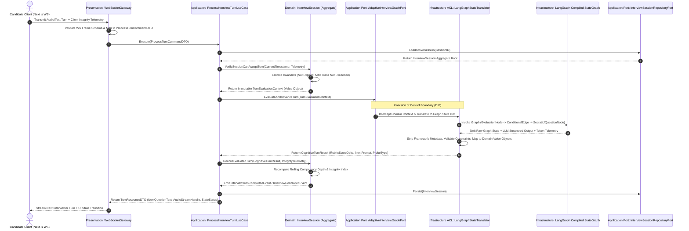

# AI Talent Screener & Technical Interviewer
## Phase 2: Clean Architecture Blueprint, SOLID Matrix & Component Mapping

* **Document ID:** `ARCH-SPEC-PHASE-02`
* **Architectural Paradigm:** Clean Architecture (Robert C. Martin), Hexagonal Ports & Adapters, Tactical DDD, SOLID Design Governance
* **Implementation Policy:** Strict Zero-Code Conceptual & Mathematical Specification
* **Prerequisite Context:** Builds upon Phase 1 Strategic & Tactical DDD Bounded Contexts (*Recruitment Management*, *Document Intelligence*, *Live Interview*, and *Evaluation & Analytics*)

---

## 1. The Dependency Rule, Concentric Layer Governance & Inversion of Control (IoC)

### 1.1 Concentric Layer Topology & The Strict Inward Dependency Rule

The **AI Talent Screener & Technical Interviewer** enforces Robert C. Martin's **Dependency Rule** as a compile-time and static-analysis invariant: *Source code dependencies must point strictly inward toward higher-level policies.* Nothing in an inner circle is permitted to know anything at all about something in an outer circle—including function names, class signatures, data structures, or third-party library namespaces (such as LangChain, LangGraph, FastAPI, SQLAlchemy, Qdrant/pgvector, or OpenAI/Anthropic SDKs).

| Concentric Layer (Inner $\rightarrow$ Outer) | Architectural Altitude | Permitted Outward Dependencies | Permitted Inward Dependencies | Strictly Forbidden Awareness |
| :--- | :--- | :--- | :--- | :--- |
| **1. Domain Layer (Core Business & Scoring Logic)** | Highest Policy Level (Center) | **None ($0$ external dependencies).** Depends exclusively on the host language standard library (math, typing, dates, UUIDs, enums). | None (Innermost core). | FastAPI, Pydantic HTTP schemas, SQLAlchemy/ORM models, LangChain `Document`/`Runnable`, LangGraph `StateGraph`, Vector DB clients, Redis, WebSockets. |
| **2. Application Layer (Use Cases & Orchestration Ports)** | Application Business Rules | **None.** Cannot import from Infrastructure or Presentation layers. | **Domain Layer only** (Aggregates, Entities, Value Objects, Domain Services, Domain Events, Repository Interfaces). | Prompt templates, LLM model identifiers, vector embedding dimensions, SQL queries, HTTP status codes, WebSocket frame protocols, Celery/BullMQ worker primitives. |
| **3. Infrastructure Layer (Frameworks, Drivers & Adapters)** | Low-Level Technical Details | External vendor SDKs (LangChain, LangGraph, PostgreSQL drivers, Vector DB SDKs, Redis, Object Storage, STT/TTS engines). | **Application Layer** (implements Outbound Driven Ports, uses Application DTOs) and **Domain Layer** (maps Persistence/AI structures to Domain Aggregates via ACLs). | Presentation Layer controllers, HTTP request/response context objects, Next.js UI state. |
| **4. Presentation / Interface Layer (Delivery Mechanisms)** | External Entry / Exit Boundary | FastAPI routers, WebSocket protocol handlers, OAuth2/JWT middleware, OpenAPI documentation generators. | **Application Layer** (invokes Inbound Driving Ports / Use Cases using Request/Response DTOs). | Direct invocation of Infrastructure Adapters (e.g., calling a LangGraph workflow or SQL repository directly from a FastAPI route is a critical architectural violation). |
| **5. Composition Root (Bootstrap & IoC Wiring)** | Outermost Assembly Shell | All layers and external configuration providers (Environment Vaults, Telemetry exporters). | **All Layers** solely for instantiating concrete Infrastructure Adapters and injecting them into Application Use Cases and Presentation Controllers. | Contains **zero** business logic, routing conditionals, or data transformation rules. |

---

### 1.2 Mathematical Formulation of Architectural Coupling & Fitness Functions

To prevent architectural erosion over the platform's lifecycle, automated CI/CD fitness functions evaluate package coupling metrics derived from Robert C. Martin's package principles for every module $M_i$:

1. **Instability Metric ($I$):** Measures a module's resilience to change based on its afferent coupling ($C_a$, incoming dependencies from outside the module) and efferent coupling ($C_e$, outgoing dependencies to other modules):

$$
I(M_i) = \frac{C_e(M_i)}{C_a(M_i) + C_e(M_i)} \in [0, 1]
$$

   * **Domain Layer Invariant:** $C_e(\text{Domain}) = 0 \implies I(\text{Domain}) = 0$ (Maximally stable; independent of all external changes).
   * **Infrastructure Adapter Invariant:** $C_a(\text{Adapter}) \to 0$ (except from the Composition Root) and $C_e(\text{Adapter}) > 0 \implies I(\text{Adapter}) \to 1$ (Maximally unstable/replaceable; can be refactored or swapped without cascading impact).

2. **Abstractness Metric ($A$):** Measures the ratio of abstract contracts ($N_a$, interfaces, abstract ports, pure specifications) to total structural elements ($N_{\text{total}}$) within a module:

$$
A(M_i) = \frac{N_a(M_i)}{N_{\text{total}}(M_i)} \in [0, 1]
$$

3. **Normalized Distance from the Main Sequence ($D$):** Governs the balance between stability and abstractness:

$$
D(M_i) = \left| A(M_i) + I(M_i) - 1 \right| \in [0, 1]
$$

   * **Architectural Governance Gate:** Every module across `backend/` and `frontend/` must satisfy $D(M_i) \le 0.15$. Any pull request causing $D(M_i) > 0.15$ (pushing a module into the *Zone of Pain* where $I \approx 0, A \approx 0$ or the *Zone of Uselessness* where $I \approx 1, A \approx 1$) fails the architectural build gate.

---

### 1.3 Anti-Corruption Layer (ACL) & Hexagonal Port Isolation for LangChain and LangGraph

AI frameworks evolve rapidly and introduce paradigm-specific abstractions (e.g., LangChain `Document`, `AIMessage`, `RunnableSerializable`, and LangGraph `StateGraph`, `Command`, `CheckpointTuple`). Allowing these types to leak into Application Use Cases or Domain Entities creates catastrophic vendor lock-in.

The architecture isolates all AI orchestration through a **Dual-Barrier Anti-Corruption Layer (ACL)**:

1. **Outbound Application Port Barrier (The Contract):**
   * The Application Layer declares strictly typed, domain-centric Outbound Driven Ports (e.g., `CandidateProfileExtractionPort`, `HybridSemanticMatcherPort`, `AdaptiveInterviewOrchestratorPort`).
   * Method signatures accept only **Domain Entities/Value Objects** or **Application Command DTOs** (e.g., `InterviewTurnContextDTO`, `CompetencyRubricSnapshot`) and return pure **Application Result DTOs** or **Domain Value Objects** (e.g., `TurnEvaluationOutcome`, `ExtractedCandidateDossier`).

2. **Infrastructure ACL Translator Barrier (The Adapter):**
   * Inside the Infrastructure Layer, dedicated **ACL Translators** convert Domain Value Objects into LangChain prompt variables or LangGraph state dictionaries before graph execution.
   * Upon completion of a LangChain extraction chain or a LangGraph node transition, the ACL validates the raw LLM structured output, strips framework metadata (token usage headers, LangSmith run IDs, provider-specific finish reasons—routing those separately to the Observability Port), enforces domain type constraints, and constructs immutable Domain Value Objects before returning across the Port boundary.

---

### 1.4 Visual Architecture Diagram: Inward Dependency & IoC Resolution Topology

```mermaid
flowchart TD
    subgraph CompositionRoot["5. Composition Root (DI Container & Bootstrap)"]
        DI["IoC Container & Dependency Wiring"]
    end

    subgraph Presentation["4. Presentation / Interface Layer (FastAPI & WebSockets)"]
        REST["REST Controllers\n(Requisitions, Batches, Reports)"]
        WS["WebSocket Interview Gateway\n(Bi-directional Voice/Text)"]
    end

    subgraph Infrastructure["3. Infrastructure Layer (Adapters & External Frameworks)"]
        subgraph AIAdapters["AI & Cognitive Adapters (ACL Guarded)"]
            LCAdapter["LangChain Document & Hybrid Match Adapter"]
            LGAdapter["LangGraph Adaptive Interview Adapter"]
            SpeechAdapter["Streaming STT / TTS Audio Adapter"]
        end
        subgraph PersistenceAdapters["Persistence & Messaging Adapters"]
            PGAdapter["PostgreSQL Relational Repository Adapter"]
            VecAdapter["Vector Store Hybrid Search Adapter"]
            QueueAdapter["Distributed Task Queue & Redis PubSub Adapter"]
        end
    end

    subgraph Application["2. Application Layer (Use Cases & Hexagonal Ports)"]
        subgraph InboundPorts["Inbound Driving Ports"]
            UC_Ingest["ProcessBatchCVIngestionUseCase"]
            UC_Match["EvaluateCandidateJobMatchUseCase"]
            UC_Interview["ProcessInterviewTurnUseCase"]
            UC_Report["GenerateComparativeEvaluationUseCase"]
        end
        subgraph OutboundPorts["Outbound Driven Ports (Abstract Interfaces)"]
            Port_Doc["DocumentExtractionPort"]
            Port_Match["SemanticMatchingEnginePort"]
            Port_Graph["AdaptiveInterviewGraphPort"]
            Port_Speech["SpeechStreamPort"]
            Port_Repo["AggregateRepositoryPorts"]
            Port_Bus["DomainEventBus & TaskQueuePort"]
        end
    end

    subgraph Domain["1. Domain Layer (Pure Business Logic & Invariants)"]
        Agg_Job["JobRequisition & CompetencyRubric\n(Aggregate Root)"]
        Agg_Cand["CandidateProfile & MatchEvaluation\n(Aggregate Root)"]
        Agg_Int["InterviewSession & AdaptiveTurn\n(Aggregate Root)"]
        Agg_Rep["CandidateEvaluationReport\n(Aggregate Root)"]
        Dom_Svc["Domain Services\n(HybridScoreCalculator, IntegrityIndexService)"]
    end

    %% Dependency Directions (Strictly Inward)
    DI -.->|"Instantiates & Wires"| REST
    DI -.->|"Instantiates & Wires"| WS
    DI -.->|"Instantiates & Wires"| AIAdapters
    DI -.->|"Instantiates & Wires"| PersistenceAdapters

    REST -->|"Invokes via DTO"| InboundPorts
    WS -->|"Invokes via DTO"| UC_Interview

    InboundPorts -->|"Orchestrates"| Domain
    InboundPorts -->|"Calls Abstract Contract"| OutboundPorts

    LCAdapter ==>|"Implements (DIP)"| Port_Doc
    LCAdapter ==>|"Implements (DIP)"| Port_Match
    LGAdapter ==>|"Implements (DIP)"| Port_Graph
    SpeechAdapter ==>|"Implements (DIP)"| Port_Speech
    PGAdapter ==>|"Implements (DIP)"| Port_Repo
    VecAdapter ==>|"Implements (DIP)"| Port_Match
    QueueAdapter ==>|"Implements (DIP)"| Port_Bus

    Dom_Svc -->|"Operates On"| Agg_Job
    Dom_Svc -->|"Operates On"| Agg_Cand
    Dom_Svc -->|"Operates On"| Agg_Int
    Dom_Svc -->|"Operates On"| Agg_Rep
```

---

### 1.5 Visual Architecture Diagram: Runtime IoC & Anti-Corruption Translation Sequence

---

### 1.6 Architecture Decision Records (IoC & Anti-Corruption Governance)

#### ADR-002: Explicit Constructor Dependency Injection via Composition Root

| ADR Field | Specification Details |
| :--- | :--- |
| **Identifier** | **ADR-002: Explicit Constructor Dependency Injection & Prohibition of Service Locator Anti-Pattern** |
| **Status** | Accepted & Enforced |
| **Context** | FastAPI provides a built-in `Depends()` mechanism designed for HTTP request-scoped dependencies. However, embedding FastAPI's `Depends()` inside Application Use Cases or Domain Services couples the core business logic to the web framework and prevents identical Use Cases from executing inside background task workers (Celery/ARQ) or CLI diagnostic runners. |
| **Decision** | All Application Use Cases and Domain Services must declare their dependencies exclusively via explicit constructor parameters typed against abstract Application Ports. A centralized, framework-agnostic **Composition Root** wires concrete Infrastructure Adapters into Use Cases at application startup. FastAPI route handlers and WebSocket gateways act solely as thin delivery shims that resolve fully constructed Use Cases from the Composition Root. |
| **Alternatives Considered** | 1. *FastAPI `Depends()` throughout Application Layer:* Rejected due to framework coupling into business orchestration. 2. *Global Singleton / Service Locator Pattern:* Rejected because it hides module dependencies, violates the Dependency Inversion Principle (DIP), and impedes deterministic unit testing. |
| **Consequences** | **Positive:** 100% of Application Use Cases can be unit-tested in sub-millisecond isolation using in-memory test doubles without spinning up an HTTP server, database, or LLM client. Identical Use Cases run seamlessly across REST APIs, WebSockets, and background queues. **Trade-off:** Requires explicit wiring declarations in the Composition Root module. |

#### ADR-003: Dual-Layer State Management Between Domain Aggregate and LangGraph Checkpointer

| ADR Field | Specification Details |
| :--- | :--- |
| **Identifier** | **ADR-003: Authority Separation Between `InterviewSession` Domain Aggregate and LangGraph State Checkpointer** |
| **Status** | Accepted & Enforced |
| **Context** | LangGraph includes built-in state checkpointing (`BaseCheckpointSaver`) to persist node execution history across conversational turns. If the system relies solely on LangGraph's internal checkpointer as the system of record for an interview, core business rules (session expiration, candidate authenticity violations, rubric weight recalculations) become trapped inside opaque serialized graph blobs. |
| **Decision** | Establish a strict **Dual-Authority Separation**: The **`InterviewSession` Domain Aggregate** persisted in PostgreSQL is the **Authoritative System of Record** for business state, verified rubric scores, turn timestamps, and integrity flags. LangGraph's checkpointer is treated strictly as an **Ephemeral Cognitive Scratchpad** in the Infrastructure Layer (managing internal prompt message windows, intermediate chain-of-thought reasoning traces, and node resumption pointers). Before each graph execution, the Application Use Case passes the authoritative Domain Rubric and Competency State into the LangGraph adapter; after execution, validated outcomes are committed back to the Domain Aggregate. |
| **Alternatives Considered** | 1. *LangGraph Checkpointer as Sole Database:* Rejected; makes relational analytical querying, side-by-side candidate comparison, and strict domain invariant enforcement impossible. 2. *Stateless LangGraph (Rebuilding full graph history from SQL on every turn):* Rejected; incurs unnecessary serialization overhead for ephemeral multi-step internal node transitions within a single turn. |
| **Consequences** | **Positive:** Preserves Clean Architecture purity; enables instant SQL analytics across thousands of interviews; allows swapping or upgrading LangGraph versions without migrating core historical interview records. **Trade-off:** Requires synchronization coordination within the `UnitOfWorkPort` during turn commit. |

---

## 2. SOLID Principles Enforcement Matrix Across Core Subsystems

### 2.1 Comprehensive SOLID Enforcement Matrix

The following matrix specifies how each SOLID principle is architecturally enforced across the three primary AI/Engineering subsystems: **1. The Multi-Format CV Parser**, **2. The Hybrid Semantic Matching Engine**, and **3. The Stateful Adaptive Interview Graph**.

| SOLID Principle | Subsystem 1: Multi-Format CV Parser (LangChain Ingestion) | Subsystem 2: Hybrid Semantic Matching Engine (LangChain + Vector/BM25) | Subsystem 3: Stateful Adaptive Interview Graph (LangGraph Engine) |
| :--- | :--- | :--- | :--- |
| **Single Responsibility Principle (SRP)** *A module should have one, and only one, reason to change (tied to a single actor/axis of change).* | Decomposed into 4 single-purpose stages: 1. `BinarySanitizerAdapter` (changes only on security/virus policy updates). 2. `LayoutAwareDocumentLoader` (changes only when PDF/DOCX layout OCR mechanics change). 3. `PiiRedactionService` (changes only when compliance/privacy rules change). 4. `StructuredEntityExtractorAdapter` (changes only when LLM extraction prompt/schema evolves). | Separates retrieval mechanics from scoring policy: 1. `DenseVectorRetrievalAdapter` retrieves semantic embeddings. 2. `LexicalBM25RetrievalAdapter` computes sparse keyword statistics. 3. `HybridMatchScoringDomainService` (Pure Domain Layer) computes the weighted mathematical fusion score and hard-skill gatekeeper rules without knowing how vectors or tokens were retrieved. | Every cognitive concern is isolated into a distinct graph node and domain validator: 1. `QuestionGeneratorNode` only synthesizes questions. 2. `ResponseEvaluationNode` only grades accuracy and depth. 3. `SocraticProbeNode` only formulates targeted follow-up challenges. 4. `IntegrityAssessmentDomainService` independently calculates authenticity decay from telemetry + linguistic signals. |
| **Open/Closed Principle (OCP)** *Software entities should be open for extension, but closed for modification.* | **Adding New Document Formats (e.g., LaTeX, RTF, LinkedIn HTML):** Implemented via a Strategy Registry (`DocumentFormatParserRegistry`). Adding a new file format requires registering a new `FormatExtractorStrategy` implementation in Infrastructure; `ProcessBatchCVIngestionUseCase` undergoes **zero** modifications. | **Adding New Scoring Dimensions (e.g., GitHub Contribution Velocity or Open-Source Impact):** Implemented via composable `MatchScoringRuleSpecification` objects in the Domain Layer. New scoring dimensions plug into the `CompositeMatchEvaluator` pipeline without altering existing vector/BM25 calculation logic. | **Adding New Interview Question Archetypes (e.g., Architecture Diagramming, Debugging Scenarios, System Design Trade-offs):** Implemented via `QuestionStrategyPlugin` keyed by `CompetencyCategory`. New question strategies and rubric evaluators are registered into the graph's node factory without altering the core `ProcessInterviewTurnUseCase` or state machine routing backbone. |
| **Liskov Substitution Principle (LSP)** *Subtypes must be substitutable for their base types without altering desirable program properties (preconditions, postconditions, invariants).* | Every concrete implementation of `StructuredCVExtractorPort` (whether backed by OpenAI GPT-4o, Anthropic Claude, local vLLM, or a deterministic mock extractor) guarantees identical postconditions: returning a normalized `ExtractedCandidateDossier` where all dates are UTC-normalized, skill taxonomies are canonicalized, and confidence intervals satisfy $[0.0, 1.0]$. | Every concrete implementation of `VectorSimilaritySearchPort` (whether backed by Qdrant, pgvector, Milvus, or Pinecone) normalizes raw distance metrics (Cosine, Dot Product, Euclidean $L_2$) into a strictly bounded similarity interval $S_{\text{dense}} \in [0.0, 1.0]$ before returning across the port, ensuring the Domain Scoring Service never breaks when switching vector backends. | Any implementation of `CognitiveLLMProviderPort` injected into LangGraph nodes adheres to strict behavioral contracts: deterministic structured schema enforcement, bounded latency timeouts, and normalized `CognitiveExecutionException` wrapping. Swapping cloud LLMs for air-gapped on-premise models preserves all graph transition invariants. |
| **Interface Segregation Principle (ISP)** *Clients should not be forced to depend upon interfaces that they do not use.* | Rather than a monolithic `IDocumentService`, ports are segregated by role: - `VirusScanPort` (used by Upload Guard) - `RawTextExtractionPort` (used by Ingestion Worker) - `SemanticEntityExtractionPort` (used by Profile Builder) - `DocumentBlobStoragePort` (used by Archival Service). | Read, write, and scoring interfaces are strictly segregated: - `CandidateVectorIndexWritePort` (used only by the ingestion pipeline) - `HybridCandidateQueryPort` (used only by the matching engine) - `RubricWeightCalibrationPort` (used only by the Recruiter configuration workflow). | Segregates interview capabilities by lifecycle phase: - `InterviewGraphInitializationPort` (used at session start) - `InterviewTurnExecutionPort` (used during live WebSocket turns) - `InterviewTranscriptSynthesisPort` (used asynchronously post-interview for final report generation). |
| **Dependency Inversion Principle (DIP)** *High-level modules must not depend on low-level modules; both must depend on abstractions.* | `ExtractCandidateProfileUseCase` (Application) depends strictly on the abstract `SemanticEntityExtractionPort` defined in the Application Layer. The `LangChainStructuredCVAdapter` (Infrastructure) imports and implements that port. Neither Domain nor Application imports `langchain_core` or `langchain_community`. | `EvaluateCandidateJobMatchUseCase` depends strictly on `HybridCandidateQueryPort` and `MatchEvaluationRepositoryPort`. Concrete LangChain `EnsembleRetriever` and vector database drivers depend inward on the Application Layer's abstract port definitions. | `ProcessInterviewTurnUseCase` and `InterviewSession` (Domain) define the evaluation rubric contracts and transition rules. `LangGraphAdaptiveInterviewAdapter` depends inward on those abstractions, translating graph execution back into pure Domain Value Objects. |

---

### 2.2 Extension & Plug-ability Blueprints (Zero-Modification Scenarios)

To verify OCP, LSP, and DIP compliance, the architecture guarantees that the following four enterprise evolution scenarios require **zero lines of change** in the **Domain Layer** and **Application Layer**:

1. **Scenario A — Multi-Vendor LLM Failover & Hot-Swapping:**
   * *Requirement:* If the primary LLM provider experiences elevated $P_{99}$ latency ($> 1,800\text{ ms}$) during a live interview, seamlessly fail over to a secondary low-latency inference provider (e.g., Groq / self-hosted vLLM).
   * *Architectural Mechanism:* A resilient `CircuitBreakingLLMRouterAdapter` in the Infrastructure Layer wraps multiple concrete implementations of `CognitiveLLMProviderPort`. The LangGraph nodes and Application Use Cases remain completely oblivious to the provider switch.

2. **Scenario B — Introducing Domain-Specific Technical Question Types:**
   * *Requirement:* Expand the platform from Backend Engineering interviews to Embedded Systems & Automotive Control Systems interviews requiring hardware-register debugging and real-time OS (RTOS) scheduling probes.
   * *Architectural Mechanism:* Create a new `CompetencyRubric` template in domain configuration and register an `EmbeddedSystemsPromptStrategy` inside the Infrastructure `PromptStrategyRegistry`. The `QuestionGeneratorNode` and `SocraticProbeNode` dynamically resolve the strategy based on the rubric's `DomainTaxonomyCode` Value Object.

---

## 3. Logical Monorepo Topology (`backend/` & `frontend/`)

### 3.1 Monorepo Architectural Philosophy & Boundary Enforcement Rules

The platform is organized as a single logical repository containing two cleanly decoupled deployable units (`backend/` and `frontend/`) plus shared architectural documentation (`docs/`). Within both `backend/` and `frontend/`, directory structures mirror the **4 Clean Architecture Layers** mixed with **Screaming Architecture** (bounded context modularization).

---

### 3.2 Backend Logical Directory Hierarchy (`backend/`)

* **Root Directory:** `backend/`
  * **`domain/`** *(Layer 1: Pure Core Business Logic — Zero External Dependencies)*
    * **`shared_kernel/`**
      * `base_primitives/`: Base abstractions for `Entity`, `AggregateRoot`, `ValueObject`, `DomainEvent`, `Specification`, and `DomainError`.
      * `value_objects/`: Cross-context immutable types (`TenantId`, `UserId`, `NormalizedScore`, `ConfidenceInterval`, `DateRange`, `SkillTaxonomyCode`).
    * **`recruitment_management/`** *(Bounded Context 1)*
      * `aggregates/`: `JobRequisition`, `ScreeningBatch`.
      * `entities/`: `RequisitionCompetencyItem`, `BatchFileItem`.
      * `value_objects/`: `CompetencyRubric`, `SeniorityBand`, `MustHaveGatekeeperRule`, `TieringThresholds`.
      * `events/`: `JobRequisitionPublishedEvent`, `ScreeningBatchInitiatedEvent`, `BatchProcessingCompletedEvent`.
      * `repositories/`: Abstract repository interfaces (`JobRequisitionRepository`, `ScreeningBatchRepository`).
    * **`document_intelligence/`** *(Bounded Context 2)*
      * `aggregates/`: `CandidateProfile`, `SemanticMatchEvaluation`.
      * `entities/`: `WorkExperienceRecord`, `ProjectComplexityEvidence`, `EducationRecord`.
      * `value_objects/`: `ExtractedSkillClaim`, `ImpactMetric`, `HybridMatchScoreBreakdown`, `RecencyDecayFactor`.
      * `domain_services/`: `HybridMatchScoringDomainService`, `HardSkillGatekeeperEvaluator`, `SkillRecencyCalculator`.
      * `events/`: `CandidateProfileExtractedEvent`, `CandidateMatchScoredEvent`, `CandidateShortlistedForInterviewEvent`.
      * `repositories/`: Abstract repository interfaces (`CandidateProfileRepository`, `MatchEvaluationRepository`).
    * **`live_interview/`** *(Bounded Context 3)*
      * `aggregates/`: `InterviewSession`.
      * `entities/`: `InterviewTurn`, `CompetencyProbeTrack`.
      * `value_objects/`: `TurnEvaluationScore`, `SocraticProbeDirective`, `IntegrityFlag`, `ClientTelemetrySnapshot`, `AuthenticityIndex`.
      * `domain_services/`: `AdaptiveRoutingPolicyService`, `IntegrityAssessmentDomainService`, `LoopPreventionGuardService`.
      * `events/`: `InterviewSessionStartedEvent`, `InterviewTurnEvaluatedEvent`, `SocraticProbeTriggeredEvent`, `SuspiciousActivityFlaggedEvent`, `InterviewSessionConcludedEvent`.
      * `repositories/`: Abstract repository interfaces (`InterviewSessionRepository`).
    * **`evaluation_analytics/`** *(Bounded Context 4)*
      * `aggregates/`: `CandidateEvaluationReport`, `ComparisonMatrixSession`.
      * `value_objects/`: `RubricDimensionSummary`, `HiringRecommendationVerdict`, `ComparativeRankVector`, `StrengthWeaknessSynthesis`.
      * `domain_services/`: `CandidateNormalizationService`, `MultiCandidateRankingService`.
      * `events/`: `EvaluationReportFinalizedEvent`, `HiringManagerOverrideRecordedEvent`.
      * `repositories/`: Abstract repository interfaces (`EvaluationReportRepository`).

  * **`application/`** *(Layer 2: Use Cases, Orchestration & Hexagonal Ports)*
    * **`common/`**
      * `ports/inbound/`: Base `UseCaseExecutor`, `Command`, `Query` markers.
      * `ports/outbound/`: `UnitOfWorkPort`, `DomainEventBusPort`, `DistributedLockPort`, `TelemetryTracerPort`.
    * **`recruitment_management/`**
      * `use_cases/`: `CreateJobRequisitionUseCase`, `CalibrateCompetencyRubricUseCase`, `InitiateBulkCVBatchUseCase`, `GetBatchProgressQueryUseCase`.
      * `dtos/`: Conceptual command/query/response contracts for requisitions and batches.
      * `ports/outbound/`: `BlobStoragePresignedUrlPort`, `BatchTaskDispatchPort`.
    * **`document_intelligence/`**
      * `use_cases/`: `IngestSingleCVDocumentUseCase`, `ExecuteHybridCandidateMatchingUseCase`, `RankAndTierBatchCandidatesUseCase`.
      * `dtos/`: `RawDocumentPayloadDTO`, `ExtractedCandidateDossierDTO`, `HybridMatchResultDTO`.
      * `ports/outbound/`: `VirusScanPort`, `DocumentLayoutExtractionPort`, `PiiRedactionPort`, `StructuredCVExtractionPort`, `CandidateVectorIndexPort`, `HybridSemanticQueryPort`.
    * **`live_interview/`**
      * `use_cases/`: `InitializeInterviewSessionUseCase`, `ProcessCandidateInterviewTurnUseCase`, `RecordClientIntegrityTelemetryUseCase`, `TerminateInterviewSessionUseCase`.
      * `dtos/`: `StartInterviewCommandDTO`, `InterviewTurnInputDTO`, `InterviewTurnOutputDTO`, `CognitiveGraphContextDTO`, `CognitiveGraphResultDTO`.
      * `ports/outbound/`: `AdaptiveInterviewGraphPort`, `SpeechToTextStreamPort`, `TextToSpeechStreamPort`, `InterviewStateCheckpointPort`, `PromptInjectionGuardPort`.
    * **`evaluation_analytics/`**
      * `use_cases/`: `SynthesizeFinalEvaluationReportUseCase`, `BuildCandidateComparisonMatrixUseCase`, `ExportAuditComplianceReportUseCase`.
      * `dtos/`: `EvaluationReportDetailDTO`, `CandidateComparisonMatrixDTO`.
      * `ports/outbound/`: `NarrativeReportSynthesisPort`, `RubricDriftAnalyticsPort`.

  * **`infrastructure/`** *(Layer 3: Frameworks, Drivers, LangChain/LangGraph Adapters & ACLs)*
    * **`ai_langchain/`** *(Document Intelligence & Matching Adapters)*
      * `document_loaders/`: Concrete PDF/DOCX layout-aware parsers (`PyMuPDF` / `Unstructured` / OCR strategies).
      * `extraction_chains/`: LangChain structured extraction pipelines implementing `StructuredCVExtractionPort`.
      * `chunking_strategies/`: Semantic section and parent-child chunkers.
      * `hybrid_retrievers/`: LangChain dense embedding + sparse BM25 ensemble adapters implementing `CandidateVectorIndexPort` and `HybridSemanticQueryPort`.
      * `acl_translators/`: `LangChainToDomainDossierTranslator`.
    * **`ai_langgraph/`** *(Stateful Adaptive Interview Adapters)*
      * `graphs/`: Compiled LangGraph `StateGraph` topologies implementing `AdaptiveInterviewGraphPort`.
      * `nodes/`: `QuestionGeneratorNode`, `ResponseEvaluationNode`, `SocraticFollowUpNode`, `ScoringVerificationNode`.
      * `edges/`: Conditional edge routers translating Domain routing policies into graph transitions.
      * `prompts/`: Versioned system prompts, rubric injectors, and delimiter-isolated prompt templates.
      * `checkpointers/`: Distributed Redis/PostgreSQL LangGraph state checkpointer adapters.
      * `acl_translators/`: `DomainToLangGraphStateTranslator`, `LangGraphOutputToDomainValidator`.
    * **`security_guardrails/`**
      * `prompt_shield/`: Dual-LLM privilege separation and adversarial injection classifiers implementing `PromptInjectionGuardPort`.
      * `pii_scrubber/`: Presidio/NER-based PII redaction adapters implementing `PiiRedactionPort`.
      * `antivirus/`: ClamAV stream scanner adapter implementing `VirusScanPort`.
    * **`speech_audio/`**
      * `stt_adapters/`: Low-latency streaming Speech-to-Text adapters (Deepgram/Whisper streaming).
      * `tts_adapters/`: Low-latency streaming Text-to-Speech adapters with barge-in cancellation support.
    * **`persistence/`**
      * `postgresql/`: Relational ORM models, Alembic migrations, concrete Repository implementations, and `SqlAlchemyUnitOfWork`.
      * `vector_store/`: Qdrant / pgvector client adapters, collection managers, and payload filter builders.
      * `cache_locks/`: Redis distributed lock adapters, WebSocket session registry, and Pub/Sub backplane.
    * **`messaging_workers/`**
      * `task_queue/`: Distributed background worker definitions (Celery/ARQ), Dead-Letter Queue (DLQ) handlers, and batch progress aggregators.
      * `event_bus/`: Transactional Outbox processor and internal Domain Event dispatcher.
    * **`observability/`**
      * `tracing/`: OpenTelemetry and LangSmith/Langfuse trace exporters, token FinOps meters, and rubric drift monitors.

  * **`presentation/`** *(Layer 4: FastAPI Delivery Mechanisms)*
    * **`http_rest/`**
      * `v1/routers/`: `requisitions_router`, `screening_batches_router`, `candidates_router`, `interviews_router`, `evaluations_router`.
      * `contracts/`: Strict HTTP request/response validation schemas and error envelope formatters.
      * `middleware/`: JWT/OAuth2 Tenant RBAC middleware, Rate Limiter, Idempotency-Key interceptor, Correlation-ID injector.
    * **`websocket/`**
      * `interview_gateway/`: Bi-directional WebSocket connection manager, heartbeat monitor, audio/text frame multiplexer, and reconnection state synchronizer.
    * **`sse/`**
      * `batch_progress_stream/`: Server-Sent Events (SSE) broadcaster for real-time bulk CV upload telemetry.

  * **`bootstrap/`** *(Layer 5: Composition Root)*
    * `container/`: Dependency Injection wiring bindings (connecting Ports to concrete Adapters).
    * `settings/`: Environment configuration validation and secrets resolution.
    * `entrypoints/`: FastAPI ASGI entrypoint, Background Worker entrypoint, Outbox Relay entrypoint.

---

### 3.3 Frontend Logical Directory Hierarchy (`frontend/`)

The Next.js (App Router) frontend applies the exact same **Clean Architecture** separation to prevent UI components from directly managing WebSocket protocols, anti-cheating browser event listeners, or REST payload normalization:

* **Root Directory:** `frontend/src/`
  * **`domain/`** *(Layer 1: Frontend Domain Models & Pure Business Policies)*
    * `models/`: Immutable domain representations (`JobRequisitionModel`, `BatchTelemetryModel`, `LiveInterviewStateModel`, `CandidateComparisonMatrixModel`).
    * `services/`: Pure client-side domain logic (`ComparisonNormalizationService`, `IntegrityAnomalyPolicy`, `AudioBargeInThresholdCalculator`).
    * `contracts/`: Abstract gateway interfaces (`RequisitionGatewayPort`, `InterviewStreamGatewayPort`, `IntegrityTelemetryGatewayPort`, `EvaluationGatewayPort`).
  * **`application/`** *(Layer 2: Frontend Use Cases, State Machines & Custom Hooks)*
    * `state_machines/`: Deterministic UI state machines (`InterviewSessionStateMachine`: *Connecting $\rightarrow$ CalibratingAudio $\rightarrow$ Listening $\rightarrow$ CandidateSpeaking $\rightarrow$ Thinking $\rightarrow$ Reconnecting $\rightarrow$ Completed*).
    * `use_cases/`: Client interactors (`UploadCVBatchUseCase`, `ConductLiveInterviewUseCase`, `MonitorClientIntegrityUseCase`, `CompareCandidatesUseCase`).
    * `stores/`: Framework-agnostic reactive state stores segmented by bounded context.
  * **`infrastructure/`** *(Layer 3: Browser APIs, Network Gateways & Protocol Adapters)*
    * `http/`: Typed REST client adapters implementing Domain Gateway Ports with automatic token refresh and retry backoff.
    * `websocket/`: Multiplexed WebSocket client adapter with exponential backoff reconnection, sequence-number frame reordering, and heartbeat ping-pong.
    * `sse/`: Server-Sent Events adapter for real-time 500-CV batch progress streaming.
    * `media_devices/`: WebRTC / Web Audio API microphone capture, Voice Activity Detection (VAD), PCM audio chunk encoder, and streaming audio playback buffer.
    * `integrity_sensors/`: Browser visibility API, window focus/blur tracker, clipboard paste burst interceptor, secondary display detector, and keystroke/speech latency cadence analyzer.
  * **`presentation/`** *(Layer 4: Next.js App Router Views & Pure UI Components)*
    * `app/` *(Next.js App Router Route Groups)*:
      * `(recruiter)/requisitions/`: Job & Rubric configuration pages.
      * `(recruiter)/batches/[batchId]/`: Live bulk CV ingestion telemetry dashboard.
      * `(recruiter)/evaluations/compare/`: **Side-by-Side Candidate Comparison Matrix** workspace.
      * `(candidate)/interview/[sessionToken]/`: Interactive Candidate Interview Portal.
    * `components/`: Pure, stateless/presentational UI components (`RubricRadarChart`, `SocraticTranscriptTimeline`, `IntegrityBadgeIndicator`, `CandidateComparisonTable`, `VoiceWaveformVisualizer`).

---

## 4. Exhaustive Layer-by-Layer Component & Port Mapping

### 4.1 End-to-End Feature-to-Layer Mapping Matrix

| # | Platform Capability / Feature | Domain Layer (Aggregates, Entities, Value Objects, Domain Services) | Application Layer (Use Cases, Inbound & Outbound Ports) | Infrastructure Layer (LangChain, LangGraph, DB & Queue Adapters) | Presentation Layer (FastAPI REST, WebSocket, SSE & Next.js Views) |
| :--- | :--- | :--- | :--- | :--- | :--- |
| **F-01** | **Job Requisition & Weighted Competency Rubric Creation** | `JobRequisition` (AR), `CompetencyRubric` (VO), `MustHaveGatekeeperRule` (VO), `RubricWeightInvariants`. | **UC:** `CreateJobRequisitionUseCase` **In:** `CreateRequisitionCommandPort` **Out:** `JobRequisitionRepositoryPort`, `UnitOfWorkPort`. | `PostgresJobRequisitionRepository`, `SqlAlchemyUnitOfWork`, `JdCompetencySuggestionAdapter` (LangChain). | `POST /api/v1/requisitions` Recruiter Rubric Builder View. |
| **F-02** | **Bulk CV Batch Upload & Presigned Ingestion Dispatch** | `ScreeningBatch` (AR), `BatchFileItem` (Entity), `BatchQuotaInvariant` ($\le 500$ files). | **UC:** `InitiateBulkCVBatchUseCase` **In:** `InitiateBatchCommandPort` **Out:** `ScreeningBatchRepositoryPort`, `BlobStoragePort`, `BatchTaskDispatchPort`. | `S3CompatibleBlobStorageAdapter`, `CeleryBatchTaskDispatcher`, `PostgresScreeningBatchRepository`. | `POST /api/v1/requisitions/{id}/batches` `GET /api/v1/batches/{id}/stream` (SSE). |
| **F-03** | **Asynchronous Multi-Format CV Parsing & Entity Extraction** | `CandidateProfile` (AR), `WorkExperienceRecord` (Entity), `ProjectComplexityEvidence` (Entity), `ExtractedSkillClaim` (VO). | **UC:** `IngestSingleCVDocumentUseCase` **In:** `IngestDocumentWorkerPort` **Out:** `VirusScanPort`, `DocumentLayoutExtractionPort`, `PiiRedactionPort`, `StructuredCVExtractionPort`. | `ClamAvScannerAdapter`, `UnstructuredLayoutParserAdapter`, `PresidioPiiRedactorAdapter`, `LangChainStructuredCVExtractorAdapter` (ACL). | Invoked via Background Worker Consumer; publishes progress via SSE Stream Controller. |
| **F-04** | **Semantic Chunking & Multi-Tenant Vector Indexing** | `CandidateProfile` (AR), `SemanticChunkMetadata` (VO), `TenantIsolationInvariant`. | **UC:** `IndexCandidateSemanticProfileUseCase` **In:** `ProfileIndexingEventHandler` **Out:** `CandidateVectorIndexPort`. | `LangChainParentChildChunkerAdapter`, `QdrantHybridVectorIndexAdapter` (Dense + Sparse BM25 vectors). | Internal event-driven workflow triggered by `CandidateProfileExtractedEvent`. |
| **F-05** | **Hybrid Semantic Matching & Candidate Tiering** | `SemanticMatchEvaluation` (AR), `HybridMatchScoreBreakdown` (VO), `HybridMatchScoringDomainService`, `HardSkillGatekeeperEvaluator`. | **UC:** `ExecuteHybridCandidateMatchingUseCase` **In:** `EvaluateBatchMatchesCommandPort` **Out:** `HybridSemanticQueryPort`, `MatchEvaluationRepositoryPort`. | `LangChainEnsembleHybridRetrieverAdapter`, `PostgresMatchEvaluationRepository`. | `POST /api/v1/batches/{id}/evaluate` Recruiter Shortlist Leaderboard UI. |
| **F-06** | **Interview Invitation & Secure Session Provisioning** | `InterviewSession` (AR), `CompetencyProbeTrack` (Entity), `SessionTokenClaims` (VO). | **UC:** `InitializeInterviewSessionUseCase` **In:** `ProvisionInterviewSessionPort` **Out:** `InterviewSessionRepositoryPort`, `AdaptiveInterviewGraphPort`. | `PostgresInterviewSessionRepository`, `LangGraphInitializerAdapter`, `RedisSessionTokenStore`. | `POST /api/v1/interviews/sessions` Candidate Portal Onboarding Lobby UI. |
| **F-07** | **Dynamic Contextual Question Generation** | `InterviewSession` (AR), `InterviewTurn` (Entity), `ActiveCompetencyFocus` (VO). | **UC:** `GenerateOpeningOrNextQuestionUseCase` **In:** `InterviewTurnOrchestrationPort` **Out:** `AdaptiveInterviewGraphPort`. | `LangGraphQuestionGeneratorNode`, `DomainToLangGraphStateTranslator` (ACL). | Delivered via WebSocket Event `server.interview.question_ready`. |
| **F-08** | **Real-Time Response Evaluation & Socratic Adaptive Branching** | `InterviewSession` (AR), `TurnEvaluationScore` (VO), `SocraticProbeDirective` (VO), `AdaptiveRoutingPolicyService`, `LoopPreventionGuardService`. | **UC:** `ProcessCandidateInterviewTurnUseCase` **In:** `ProcessInterviewTurnPort` **Out:** `PromptInjectionGuardPort`, `AdaptiveInterviewGraphPort`, `InterviewSessionRepositoryPort`. | `PromptShieldClassifierAdapter`, `LangGraphEvaluationNode`, `LangGraphSocraticFollowUpNode`, `LangGraphConditionalEdgeRouter`, `RedisLangGraphCheckpointer`. | Bi-directional WebSocket Gateway (`/ws/v1/interviews/{session_id}`). |
| **F-09** | **Low-Latency Voice Streaming (STT / TTS & Barge-In)** | `AudioTurnMetadata` (VO), `VoiceCadenceMetrics` (VO). | **UC:** `OrchestrateVoiceStreamTurnUseCase` **In:** `VoiceStreamControllerPort` **Out:** `SpeechToTextStreamPort`, `TextToSpeechStreamPort`. | `StreamingSTTAdapter` (Deepgram/Whisper), `StreamingTTSAdapter` (ElevenLabs/Cartesia) with cancellation tokens. | Binary/Multiplexed WebSocket Audio Frames + Candidate Waveform UI. |
| **F-10** | **Client-Side Integrity Telemetry & Authenticity Scoring** | `IntegrityFlag` (VO), `ClientTelemetrySnapshot` (VO), `AuthenticityIndex` (VO), `IntegrityAssessmentDomainService`. | **UC:** `RecordClientIntegrityTelemetryUseCase` **In:** `IngestIntegritySignalPort` **Out:** `InterviewSessionRepositoryPort`. | `PostgresInterviewSessionRepository`, `RedisTelemetryTimeSeriesBuffer`. | WebSocket Event `client.telemetry.integrity_ping` from Next.js `IntegritySensorsAdapter`. |
| **F-11** | **Post-Interview Verification & Comprehensive Report Synthesis** | `CandidateEvaluationReport` (AR), `RubricDimensionSummary` (VO), `HiringRecommendationVerdict` (VO). | **UC:** `SynthesizeFinalEvaluationReportUseCase` **In:** `InterviewConcludedEventHandler` **Out:** `AdaptiveInterviewGraphPort` (`ScoringVerificationNode`), `EvaluationReportRepositoryPort`. | `LangGraphScoringVerificationNode`, `PostgresEvaluationReportRepository`. | `GET /api/v1/evaluations/{report_id}` Recruiter Deep-Dive Scorecard UI. |
| **F-12** | **Side-by-Side Multi-Candidate Comparison Matrix** | `ComparisonMatrixSession` (AR), `ComparativeRankVector` (VO), `CandidateNormalizationService`, `MultiCandidateRankingService`. | **UC:** `BuildCandidateComparisonMatrixUseCase` **In:** `CompareCandidatesQueryPort` **Out:** `EvaluationReportRepositoryPort`, `MatchEvaluationRepositoryPort`. | `PostgresAnalyticalReadModelAdapter` (Optimized CQRS read projection). | `POST /api/v1/evaluations/compare` Next.js **Side-by-Side Candidate Comparison Matrix** UI. |

---

### 4.2 Detailed Outbound Driven Port Specifications (Core AI & Orchestration Boundaries)

To enforce strict contract-first design without implementation code, the three foundational AI Outbound Driven Ports are specified below with their formal preconditions, postconditions, conceptual input/output contracts, and failure modes.

#### Port Specification 1: `StructuredCVExtractionPort` (Application $\rightarrow$ Infrastructure LangChain Adapter)

| Contract Element | Architectural Specification |
| :--- | :--- |
| **Port Identifier** | `application.document_intelligence.ports.outbound.StructuredCVExtractionPort` |
| **Implemented By** | `infrastructure.ai_langchain.extraction_chains.LangChainStructuredCVExtractorAdapter` |
| **Operation Signature** | `ExtractStructuredDossier(sanitized_document: SanitizedDocumentPayloadDTO, taxonomy_context: SkillTaxonomySnapshotDTO) -> ExtractedCandidateDossierDTO` |
| **Preconditions** | 1. `sanitized_document` has passed ClamAV binary scanning (`is_malware_free = true`). 2. Raw text and structural layout blocks are non-empty ($\text{length}(\text{text}) \ge 100\text{ characters}$). 3. Direct PII tokens (National IDs, Phone Numbers, Exact Street Addresses, Demographic markers) have been masked by `PiiRedactionPort` into deterministic placeholders. |
| **Postconditions** | 1. Returns a fully populated, immutable `ExtractedCandidateDossierDTO`. 2. Every extracted `SkillClaim` is mapped either to a canonical `SkillTaxonomyCode` or marked as `UnmappedEmergingSkill` with an explicit evidence quote from the source text. 3. Total calculated experience duration reconciles mathematically with individual `WorkExperienceRecord` date ranges (overlapping employment periods are deduplicated). 4. Zero LangChain framework objects or raw LLM completion dictionaries cross the return boundary. |
| **Failure Modes & Exceptions** | - `CorruptedDocumentStructureError`: Document text is garbled or unparseable even after OCR fallback. - `LLMExtractionSchemaViolationError`: LLM output failed structured schema validation after maximum self-correction retries ($N_{\text{retry}} = 2$). - `UpstreamAICapacityTimeoutError`: Upstream LLM provider exceeded timeout threshold ($t > 25\text{ seconds}$); triggers exponential backoff retry in the distributed task queue. |

#### Port Specification 2: `HybridSemanticQueryPort` (Application $\rightarrow$ Infrastructure LangChain + Vector/BM25 Adapter)

| Contract Element | Architectural Specification |
| :--- | :--- |
| **Port Identifier** | `application.document_intelligence.ports.outbound.HybridSemanticQueryPort` |
| **Implemented By** | `infrastructure.ai_langchain.hybrid_retrievers.LangChainEnsembleHybridRetrieverAdapter` |
| **Operation Signature** | `RetrieveCandidateCompetencyEvidence(candidate_id: CandidateId, tenant_id: TenantId, rubric_criteria: Collection<CompetencyCriterionVO>) -> CandidateRetrievalEvidenceBundleDTO` |
| **Preconditions** | 1. `tenant_id` is non-null and cryptographically verified from the execution context. 2. `candidate_id` has completed vector indexing in the tenant's isolated namespace. 3. `rubric_criteria` contains $\ge 1$ valid competency criterion with normalized weight $w_i \in (0.0, 1.0]$ where $\sum w_i = 1.0$. |
| **Postconditions** | 1. Queries execute strictly within the partition filter `tenant_id == context.tenant_id AND candidate_id == context.candidate_id` (Zero cross-tenant data leakage). 2. For each `CompetencyCriterionVO`, returns normalized Dense Cosine Similarity score $S_{\text{dense}, i} \in [0.0, 1.0]$, normalized Sparse BM25 score $S_{\text{sparse}, i} \in [0.0, 1.0]$, and the top-$k$ supporting verbatim resume evidence chunks. 3. Does **not** compute the final hiring tier (which belongs exclusively to `HybridMatchScoringDomainService` in the Domain Layer). |
| **Failure Modes & Exceptions** | - `TenantNamespaceViolationError`: Security invariant halt if tenant context mismatches index metadata. - `VectorIndexUnavailableError`: Transient connection failure to Vector DB cluster. - `CandidateEmbeddingsNotFoundError`: Requested candidate profile has not yet been indexed. |

#### Port Specification 3: `AdaptiveInterviewGraphPort` (Application $\rightarrow$ Infrastructure LangGraph Adapter)

| Contract Element | Architectural Specification |
| :--- | :--- |
| **Port Identifier** | `application.live_interview.ports.outbound.AdaptiveInterviewGraphPort` |
| **Implemented By** | `infrastructure.ai_langgraph.graphs.LangGraphAdaptiveInterviewAdapter` |
| **Operation Signature** | `ExecuteCognitiveTurn(turn_context: CognitiveGraphContextDTO) -> CognitiveGraphResultDTO` |
| **Preconditions** | 1. `turn_context` contains the authoritative state snapshot from the `InterviewSession` Domain Aggregate (current competency rubric target, current depth level $d \in \{1, 2, 3, 4\}$, follow-up probe count $c_{\text{probe}}$ for current competency, and sanitized candidate response text). 2. Candidate response text has been pre-screened by `PromptInjectionGuardPort`. 3. Session wall-clock timer and turn counter invariants are verified active by the Domain Aggregate. |
| **Postconditions** | 1. Executes the deterministic LangGraph state transition: `EvaluationNode` $\rightarrow$ `ConditionalRoutingEdge` $\rightarrow$ (`SocraticFollowUpNode` OR `QuestionGeneratorNode` OR `ScoringVerificationNode`). 2. Returns an immutable `CognitiveGraphResultDTO` containing:    - Multi-dimensional rubric evaluation for the candidate's answer (`TechnicalAccuracy` $\in [0, 5]$, `ArchitecturalDepth` $\in [0, 5]$, `PracticalRelevance` $\in [0, 5]$).    - Verified factual rationale and citations to candidate statements.    - Linguistic AI-generation suspicion score $P_{\text{synthetic}} \in [0.0, 1.0]$.    - The transition decision (`PROBE_SOCRATIC`, `ADVANCE_DEPTH`, `SWITCH_COMPETENCY`, `CONCLUDE_INTERVIEW`).    - The next interviewer utterance text ready for streaming TTS and client display. 3. Completes graph execution within $P_{95} \le 1,250\text{ ms}$ to preserve the overall turn latency budget ($L_{\text{turn}} \le 1,850\text{ ms}$). |
| **Failure Modes & Exceptions** | - `AdversarialInputContainmentTriggeredError`: Evaluation Node detected an embedded jailbreak or rubric-override attempt inside the candidate's answer. - `GraphStateCheckpointerConflictError`: Concurrent turn mutation detected via optimistic concurrency version mismatch. - `CognitiveNodeLatencyBudgetExceededError`: Primary LLM exceeded strict turn deadline, triggering immediate fallback to secondary low-latency model or graceful conversational acknowledgment. |

---

### 4.3 Conceptual Data Contract: `CognitiveGraphContextDTO` & `CognitiveGraphResultDTO`

To guarantee a clean boundary between the **Application Use Case** (`ProcessCandidateInterviewTurnUseCase`) and the **LangGraph Infrastructure Adapter**, the exact conceptual data schemas crossing `AdaptiveInterviewGraphPort` are defined below:

| Contract Direction | Field Name | Conceptual Data Type | Constraints & Validation Rules | Domain Purpose |
| :--- | :--- | :--- | :--- | :--- |
| **Input (`CognitiveGraphContextDTO`)** | `session_id` | `UUIDv7` | Required; immutable session identifier. | Correlates domain session with LangGraph thread/checkpoint ID. |
| **Input (`CognitiveGraphContextDTO`)** | `turn_sequence_number` | `Integer` | $1 \le n \le N_{\text{max\_turns}}$ (default $N_{\text{max}} = 18$). | Enforces strict sequential turn ordering and idempotency. |
| **Input (`CognitiveGraphContextDTO`)** | `candidate_dossier_summary` | `ReadOnlyCollection<ProjectEvidenceSummaryVO>` | Max $1,500$ tokens equivalenced; PII-free. | Grounds question generation and Socratic probing in the candidate's actual claimed projects. |
| **Input (`CognitiveGraphContextDTO`)** | `active_competency_rubric` | `CompetencyCriterionVO` | Contains `CompetencyCode`, `TargetSeniorityLevel`, `ExpectedDepthIndicators`, and `Weight`. | Anchors the `EvaluationNode` to deterministic grading criteria rather than subjective LLM opinion. |
| **Input (`CognitiveGraphContextDTO`)** | `current_competency_depth` | `Integer (Enum: L1_Foundational..L4_Principal)` | $d \in \{1, 2, 3, 4\}$. | Governs the complexity of the current technical exchange. |
| **Input (`CognitiveGraphContextDTO`)** | `socratic_followup_count` | `Integer` | $0 \le c_{\text{probe}} \le C_{\text{max\_probes}}$ (default $C_{\text{max}} = 2$). | Passed from Domain Aggregate to enforce hard loop-prevention invariants inside conditional edges. |
| **Input (`CognitiveGraphContextDTO`)** | `sanitized_candidate_utterance` | `String` | Non-empty; $\le 4,000$ characters; wrapped in untrusted data delimiters. | The candidate's transcribed or typed answer to the active question. |
| **Input (`CognitiveGraphContextDTO`)** | `turn_telemetry_signals` | `ClientTelemetrySnapshotVO` | Includes `ResponseLatencyMs`, `PasteEventDetected`, `FocusLostDurationMs`, `SpeechPauseEntropy`. | Provides behavioral signals to correlate with linguistic synthetic-answer detection. |
| **Output (`CognitiveGraphResultDTO`)** | `turn_evaluation` | `TurnEvaluationScoreVO` | `Accuracy` $\in [0.0, 5.0]$, `Depth` $\in [0.0, 5.0]$, `Relevance` $\in [0.0, 5.0]$, `EvidenceRationale` (String). | Structured rubric grade committed to the `InterviewTurn` entity. |
| **Output (`CognitiveGraphResultDTO`)** | `synthetic_likelihood_score` | `Decimal` | Bounded $[0.0, 1.0]$. | Linguistic probability that the candidate is reading verbatim from an external LLM output. |
| **Output (`CognitiveGraphResultDTO`)** | `routing_action_taken` | `Enum` | One of: `SOCRATIC_CLARIFICATION`, `SOCRATIC_CHALLENGE_ASSUMPTION`, `SOCRATIC_AUTHENTICITY_PROBE`, `ESCALATE_DIFFICULTY`, `TRANSITION_NEXT_COMPETENCY`, `CONCLUDE_INTERVIEW`. | Records the exact cognitive branch selected for auditability and state updates. |
| **Output (`CognitiveGraphResultDTO`)** | `next_interviewer_utterance` | `String` | Non-empty conversational prompt; $\le 600$ characters for voice clarity. | The next question or Socratic follow-up spoken/displayed to the candidate. |
| **Output (`CognitiveGraphResultDTO`)** | `updated_checkpoint_version` | `String (Hash/Version)` | Non-empty optimistic lock token. | Confirms the infrastructure checkpointer synchronized cleanly with the domain turn. |